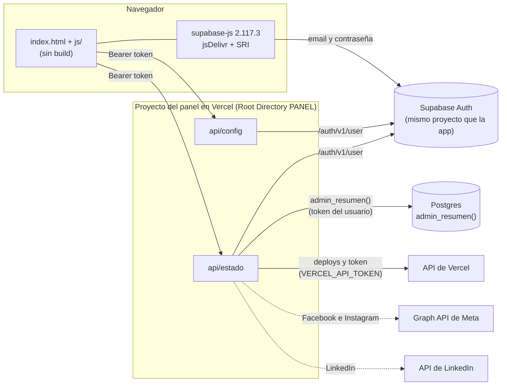

# Panel de SPOT · diseño

Documento de referencia del panel de administración. Lo siguen todos los prompts del panel: si algo cambia, se cambia acá primero.

Lo marcado **a confirmar** no se pudo comprobar en la documentación oficial al escribir este diseño (28 de octubre de 2026). Se confirma en el prompt de su integración.

## 1. Objetivo y alcance

**Qué es:** un panel de uso exclusivo del dueño del proyecto para ver en un solo lugar cómo va SPOT:
- la app (casos, reencuentros, coincidencias, moderación, cuentas, reconocimiento);
- la infraestructura (Vercel, Supabase y el servicio de visión);
- las redes (Facebook, Instagram y LinkedIn);
- los tokens que vencen.

Cuando algo anda mal, cada tarjeta lleva con un link directo a la pantalla del servicio correspondiente.

**Qué no es:**
- No modera ni cambia datos: solo lee. Moderar sigue siendo cosa de la app (pantalla de moderación).
- No muestra datos personales: ni nombres, ni emails, ni mensajes, ni ubicaciones, ni descripciones. Muestra conteos, estados y tendencias.
- No reemplaza los dashboards de cada servicio: resume y lleva a ellos.

**Dónde vive:** en la carpeta `PANEL/` de este repo. Se despliega como un proyecto de Vercel aparte del de la app, con Root Directory `PANEL`. No comparte código con la app: lo que necesita de ella se copia y se anota de dónde salió.

**Lo hecho:**
- **Esqueleto:** ingreso, acceso denegado y cierre de sesión; el Inicio con todas las secciones y tarjetas, en computadora y celular, claro y oscuro; `api/config` y `api/estado`.
- **Datos internos:** la migración 0028 (`supabase/migrations/20261028000028_panel_admin.sql`: la tabla `administradores`, `es_admin()` y `admin_resumen()`) y las tarjetas de La app, Supabase y el servicio de visión, con datos.
- **Vercel:** el último deploy de producción de la app y el vencimiento de `VERCEL_API_TOKEN`.

Redes, los tokens de Meta y LinkedIn y las alertas todavía dicen qué les falta: llegan con los prompts de la sección 9.

## 2. Arquitectura

**En el navegador** (`index.html`, `estilos.css`, `js/`, `i18n/`), sin framework ni paso de build:
- arma las pantallas con `createElement` y `textContent`;
- hace el ingreso con supabase-js (solo Auth), cargado desde jsDelivr con versión fija y hash SRI;
- guarda la sesión en `sessionStorage`;
- le pide todo lo demás a las funciones del panel, con el token de la sesión.

No habla con ningún otro servicio.

**En las funciones de Vercel** (`api/`, runtime de Node, sin dependencias, con `fetch`):
- `api/config`:
  - sin sesión, la URL y la clave pública de Supabase y qué variables faltan para entrar;
  - con una sesión de administración, además, los datos no secretos para armar los links.
- `api/estado`: valida la sesión y el permiso, lee las fuentes (`admin_resumen()` con el token de la sesión y la API de Vercel) y devuelve el estado de cada parte del panel y de cada tarjeta, con sus datos.
- Los archivos `api/_*.js` son compartidos: Vercel no publica como función un archivo de `api/` que empieza con `_`.

**Los secretos** (tokens de Vercel, Meta y LinkedIn) viven solo en las variables del proyecto del panel en Vercel y solo los leen las funciones.



Las líneas punteadas son de los prompts siguientes.

**Archivos:**

| Ruta | Qué es |
| --- | --- |
| `index.html` | La página. Incluye los íconos SVG (`<symbol>`) y carga supabase-js con SRI. |
| `estilos.css` | Todos los colores (variables), las fuentes y el diseño. |
| `js/app.js` | El arranque: config, sesión, estado e Inicio. |
| `js/pantallas.js`, `js/inicio.js` | Las pantallas centradas y el Inicio. |
| `js/componentes.js` | Piezas: marca, pastilla, botones, link "Abrir en…", líneas de "qué falta". |
| `js/catalogo.js` | Qué tarjetas hay, en qué orden y a dónde lleva cada link. |
| `js/datos.js` | Revisa lo que llega del servidor y de Supabase Auth, y arma los avisos (funciones puras). |
| `js/vistaDeDatos.js`, `js/formato.js` | Lo que muestra una tarjeta con datos, y los números, tamaños y fechas en es-UY. |
| `js/enlaces.js` | Arma las URLs de los links y las valida. |
| `js/sesion.js`, `js/api.js`, `js/tiempo.js` | Sesión, pedidos a `api/` y "hace X min". |
| `i18n/es-UY.js` | Todos los textos. |
| `api/config.js`, `api/estado.js` | Las funciones. |
| `api/_comun.js`, `api/_catalogo.js` | Variables, validaciones, sesión y el estado de cada parte y tarjeta según las variables. |
| `api/_fuentes.js`, `api/_tarjetas.js` | Las fuentes de datos (`admin_resumen()` y la API de Vercel) y los umbrales de cada tarjeta. |
| `fuentes/` | IBM Plex en woff2, la licencia OFL y `ORIGEN.md` (de dónde salió cada archivo). |
| `vercel.json` | Encabezados de seguridad. |
| `.vercelignore` | Lo que no se publica (documentación, propuestas, pruebas, herramientas). |
| `pruebas/` | `node --test` de las funciones y la lógica de la página. |
| `herramientas/verificar.mjs` | Revisa sintaxis, colores, secretos, textos y fuentes. |

## 3. Pantallas y tarjetas

### 3.1 Estados

Cada tarjeta, fila o parte muestra uno de cinco estados, siempre con color, ícono y texto:

| Estado | Cuándo | Pastilla |
| --- | --- | --- |
| Funciona / Al día | Hay datos y están bien. "Al día" se usa en los tokens. | círculo con tilde |
| Atención | Hay datos y algo conviene mirarlo pronto (umbrales abajo). | triángulo con ! |
| Falla | Algo no anda: el servicio no responde, un deploy falló o una variable tiene un valor que no sirve. | círculo con X |
| Pendiente | Tiene su configuración, pero los datos llegan con un prompt que todavía no se hizo, o falta la migración. Dice qué prompt la resuelve. | reloj |
| Sin configurar | Falta una variable para tener datos. Dice cuál. | círculo con guion |

**Pendiente y Sin configurar** usan la tarjeta de borde punteado. Además de la pastilla, llevan:
- una línea que explica qué falta: la variable en mono o el nombre del prompt;
- su link "Abrir en…", si su variable está.

**Una tarjeta pendiente nunca muestra números.** Ni ceros, ni gráficas vacías, ni barras de uso: un cero también sería un dato inventado.

### 3.2 Ingreso, acceso denegado y errores

- **Ingreso:** email y contraseña con Supabase Auth, en el mismo proyecto que la app.
  - Los errores salen de `t.ingreso.errores`, nunca el mensaje en inglés de Supabase: credenciales, email sin confirmar, muchos intentos, captcha, red y otro.
  - **Sin las tres variables de ingreso** (`SUPABASE_URL`, `SUPABASE_PUBLISHABLE_KEY` y `ADMIN_USER_IDS`), o con alguna que no sirve, el formulario queda deshabilitado y la pantalla dice cuáles faltan, por nombre. Sin Supabase no hay con qué entrar, así que no hay Inicio que mostrar.
  - **Si supabase-js no carga** (el CDN no responde o el archivo no coincide con el hash), lo dice y deshabilita el formulario.
- **Acceso denegado:** si `api/estado` o `api/config` responden 403, la página:
  1. cierra la sesión (`signOut({ scope: 'local' })`);
  2. muestra "Acceso denegado" con "Volver a ingresar".
- **Sesión vencida:** si responden 401, cierra la sesión y vuelve al ingreso con "Tu sesión venció. Entrá de nuevo.".
- **Servidor caído:** si `api/config` no responde al abrir, se ve "No se pudo cargar el panel" con "Reintentar". Si falla una actualización, el Inicio suma una Falla en "Necesita atención" con "Reintentar" y deja lo que ya mostraba.

### 3.3 Inicio

**Cabecera:**
- la marca;
- "Actualizado hace X min";
- los botones "Actualizar" y "Salir".

"Actualizar" vuelve a pedir el estado. También se actualiza solo al volver a la pestaña si pasaron más de 5 minutos.

**Vistas:** se eligen con el hash: `#/` (Inicio), `#/app`, `#/infraestructura`, `#/redes` y `#/tokens`.
- El Inicio muestra todas las secciones.
- Cada una de las otras muestra solo la suya, para que los prompts siguientes le sumen detalle.
- Atrás del navegador vuelve a la vista anterior.

**Orden del contenido:**
1. **Necesita atención:** las Fallas primero y después las de Atención, con el resumen arriba a la derecha (por ejemplo, "1 falla · 2 avisos"). Lo pendiente y lo sin configurar no va acá: va en el bloque siguiente. Una tarjeta que falla por una variable inválida tampoco, porque ya la avisa su parte de la configuración.
2. **Configuración del panel:** se ve mientras falte algo. Tiene una fila por parte, con su estado y qué le falta:
   - Ingreso y permisos
   - Links a los servicios
   - Datos de la app
   - Vercel
   - Facebook e Instagram
   - LinkedIn
   - Alertas
3. **La app.**
4. **Infraestructura.**
5. **Redes.**
6. **Tokens.**

### 3.4 Las tarjetas

**Cómo leer esta sección:**
- **Rutas:** las del dashboard de Supabase son relativas a `https://supabase.com/dashboard/project/<ref>`, con el ref sacado de `SUPABASE_URL`.
- **Umbrales:** los de Atención y Falla son la propuesta inicial (sección 10, decisión 6). Están en `api/_tarjetas.js` (`UMBRALES` y `LIMITES`), con sus pruebas en `pruebas/api.test.mjs`.
- **Motivos:** cada Atención o Falla lleva un código (`motivo`) con su texto en `t.motivos`. Lo que es de una fuente entera (Supabase no responde, el token de Vercel no sirve) lo avisa una sola vez su parte de la configuración, no cada tarjeta.
- **Prompts:** el número entre paréntesis es el del plan de la sección 9.

#### La app

Todas salen de `admin_resumen()` (migración 0028). La función de `api/estado` la llama por PostgREST (`POST /rest/v1/rpc/admin_resumen`, cuerpo `{}`, 5 s de tope):
- con el token de la sesión en `Authorization`;
- con la clave pública en `apikey`.

Variables: ninguna aparte de las de ingreso. Si la función no existe (sin la migración), quedan en **Pendiente**; si la cuenta no está en `administradores` o la base no responde, en **Falla**. En los dos casos, sin números.

| Tarjeta | Qué muestra | De dónde sale (`admin_resumen`) | Atención | Falla | "Abrir en…" |
| --- | --- | --- | --- | --- | --- |
| Casos nuevos | En 24 h y en 7 días, con la gráfica de 7 barras (hoy en acento, los demás en barra suave) | `casos.nuevos_24h`, `nuevos_7d`, `por_dia`: `animales.created_at`, sin datos de demo | Ningún caso en 7 días (puede ser que publicar esté roto) | — | Supabase, `/editor` (a confirmar la ruta directa a la tabla) |
| Casos reunidos | Total y en los últimos 30 días | `casos.reunidos` (`estado = 'reunido'`) y `reunidos_30d` (`cambios_estado`) | — | — | La app, `<LINK_APP_URL>/reencuentros` |
| Coincidencias pendientes | Cuántas y desde cuándo espera la más vieja | `coincidencias.pendientes`, `pendiente_desde` | Alguna espera hace más de 3 días | — | Supabase, `/editor` |
| Denuncias y ocultos | Denuncias sin revisar, casos e historias ocultos y reportes de error sin resolver | `moderacion.*` | Alguna denuncia pendiente o algún reporte de error sin resolver | — | Supabase, `/editor`. A futuro, la pantalla de moderación de la app (a confirmar su ruta) |
| Usuarios nuevos | En 24 h y en 7 días, y el total | `usuarios.*` (`perfiles.created_at`) | — | — | Supabase, `/auth/users` |
| Fotos trabadas | Fotos de `cola_vision` que esperan hace más de 30 min y las que se quedaron sin reintentos | `vision.trabadas`, `sin_reintentos`, `esperando_desde` | Alguna trabada | Alguna sin reintentos, o la más vieja espera hace más de 2 h | Supabase, `/functions` (Edge Functions; a confirmar `/functions/reconocer/logs`) |

#### Infraestructura

| Tarjeta | Qué muestra | De dónde y cómo | Variables | Atención | Falla | "Abrir en…" |
| --- | --- | --- | --- | --- | --- | --- |
| Vercel | Estado, commit (hash corto en mono) y hora del último deploy de producción de la app | API de Vercel: `GET /v7/deployments?projectId=<proyecto>&slug=<equipo>&target=production&state=BUILDING,ERROR,INITIALIZING,QUEUED,READY,BLOCKED&limit=5`. El filtro de `state` deja afuera los CANCELED, porque el Ignored Build Step cancela builds a propósito. De la lista: `readyState`, `createdAt`, `inspectorUrl` y `meta.githubCommitSha` (comprobado con los deploys de la app). | `VERCEL_API_TOKEN` (secreta), `LINK_VERCEL_TEAM`, `LINK_VERCEL_PROJECT` | Un deploy en BUILDING, INITIALIZING o QUEUED hace más de 15 min, o ningún deploy | El último está en ERROR o BLOCKED: su botón primario es "Ver log en Vercel", al `inspectorUrl` de ese deploy. También si el token no sirve, Vercel no encuentra el proyecto o no responde en 5 s | `https://vercel.com/<equipo>/<proyecto>/deployments` |
| Supabase | Si el proyecto responde, y el tamaño de la base (de 500 MB) y de Storage (de 1 GB) con barras de uso contra el plan gratuito | `admin_resumen()`: si responde, el proyecto responde (no hace falta `/auth/v1/health`). `almacenamiento.base_bytes` (`pg_database_size`) y `storage_bytes` (suma de `storage.objects.metadata->size`). Los límites, en unidades decimales (500 × 10⁶ y 10⁹ bytes). | Las de ingreso | Base o Storage en el 80 % o más | No responde en 5 s (también si el proyecto se pausó por inactividad), o en el 95 % o más | `/reports/database` (Database Size) |
| Servicio de visión | El reconocimiento con IA (función `reconocer`, 0018): fotos en espera, llamadas a la IA en 24 h y sus errores, y la última foto procesada | `admin_resumen()`: `vision.esperando`, `llamadas_ia_24h`, `errores_ia_24h`, `ia_activa`, `ia_pausa` y `ultima_procesada` | Las de ingreso | La IA está apagada (`ia_activa`), o alguna llamada a la IA falló en 24 h | La IA se quedó sin crédito (`ia_pausa = 'sin_credito'`): se reactiva desde Moderación, en la app | Supabase, `/functions` (Edge Functions; a confirmar `/functions/reconocer/logs`) |

**El servicio de visión es la función `reconocer`** (sección 10, decisión 1): se mira desde la base, sin variables ni tokens. Las fotos trabadas o sin reintentos las avisa solo "Fotos trabadas", para no repetir el aviso.

#### Redes

Ninguna muestra el texto de las publicaciones: un aviso de animal perdido puede tener un teléfono o un nombre. De cada publicación van solo la fecha, el tipo, los números (me gusta, comentarios, alcance) y el link a la publicación.

| Tarjeta | Qué muestra | De dónde y cómo | Variables | Atención | Falla | "Abrir en…" |
| --- | --- | --- | --- | --- | --- | --- |
| Facebook | Seguidores, alcance de 28 días y las 3 últimas publicaciones | Graph API: `GET /<page-id>?fields=followers_count`. Insights: las métricas que sigan vigentes, porque las de impresiones y alcance de página se están reemplazando por `page_media_view` y `page_total_media_view_unique` (a confirmar al integrar). Publicaciones: `/<page-id>/posts?fields=created_time,permalink_url`. | `META_ACCESS_TOKEN` (secreta), `META_PAGE_ID`, `LINK_FACEBOOK_URL` | Ninguna publicación en 14 días | El token venció o le falta un permiso (error 190 o 10) | La página (`LINK_FACEBOOK_URL`) |
| Instagram | Seguidores, alcance y las 3 últimas publicaciones | `GET /<ig-user-id>?fields=followers_count,media_count`, `/<ig-user-id>/insights?metric=reach` (y `views`; `impressions` ya no existe), `/<ig-user-id>/media?fields=timestamp,permalink,like_count,comments_count,media_type` | `META_ACCESS_TOKEN`, `META_IG_USER_ID`, `LINK_INSTAGRAM_URL` | Igual que Facebook | Igual que Facebook | La cuenta (`LINK_INSTAGRAM_URL`) |
| LinkedIn | Seguidores y las últimas publicaciones con sus estadísticas, si LinkedIn aprueba la Community Management API | `networkSizes` (`edgeType=COMPANY_FOLLOWED_BY_MEMBER`), `organizationalEntityShareStatistics` y `GET /rest/posts?author=<urn>&q=author` con el header `Linkedin-Version` | `LINKEDIN_ACCESS_TOKEN` (secreta), `LINKEDIN_ORG_ID`, `LINK_LINKEDIN_URL` | Token a menos de 14 días de vencer | Token vencido | La página (`LINK_LINKEDIN_URL`) |

**Plan B de LinkedIn:** si LinkedIn no aprueba el acceso, la tarjeta queda solo con el link y una línea "Sin acceso a la API de LinkedIn". Las variables de token se borran del panel.

#### Tokens

Una lista con el vencimiento de cada token. **Al día** si vence en más de 14 días, **Atención** si vence en 14 días o menos, **Falla** si venció o no sirve.

| Token | Cómo se lee el vencimiento | "Abrir en…" |
| --- | --- | --- |
| Vercel (`VERCEL_API_TOKEN`) | `GET /v5/user/tokens/current` → `token.expiresAt`, en milisegundos. Si no viene, el token no vence ("No vence", Al día). Con el token solo, sin equipo ni proyecto, igual se lee. | `https://vercel.com/account/tokens` (a confirmar la ruta actual) |
| Meta (`META_ACCESS_TOKEN`) | `GET /debug_token?input_token=…` → `expires_at` (0 = no vence) y `data_access_expires_at` | El depurador de tokens de Meta for Developers |
| LinkedIn (`LINKEDIN_ACCESS_TOKEN`) | `POST https://www.linkedin.com/oauth/v2/introspectToken` → `expires_at`. Necesita el client id y el secret de la app de LinkedIn (dos variables secretas más, en ese prompt). | LinkedIn Developers, "My apps" |

## 4. Diseño visual

Esta sección es la maqueta aprobada, con sus valores exactos. Todo cambio visual del panel la respeta. Al final van las notas de implementación.

### 4.1 Colores

Todos los colores son variables CSS en `estilos.css`, con modo claro por defecto y modo oscuro según la preferencia del sistema (`prefers-color-scheme`).

| Uso | Claro | Oscuro |
| --- | --- | --- |
| Fondo de la página | `#F3F4F1` | `#101513` |
| Superficie (tarjetas, cabecera) | `#FFFFFF` | `#18201C` |
| Borde de tarjeta | `#DADDD6` | `#2A3530` |
| Borde de botón secundario | `#C9CEC6` | `#3A4842` |
| Separador entre filas | `#E4E7E1` | `#2A3530` |
| Borde punteado (pendiente o sin configurar) | `#B9BFB6` | `#3A4842` |
| Texto | `#17201B` | `#E8EDE9` |
| Texto secundario | `#4F5A54` | `#A3AFA8` |
| Acento | `#0B5D57` | `#5CC8B8` |
| Acento al pasar el mouse | `#08443F` | `#8FDCD0` |
| Texto sobre el acento | `#FFFFFF` | `#0D1A17` |
| Ítem activo del menú (fondo) | `#E2EDEB` | `#1F3A36` |
| Barras suaves y pista de barras de uso | `#BFD9D5` y `#E4E7E1` | `#2F4A45` y `#2A3530` |

Estados (texto y fondo de la pastilla):

| Estado | Claro | Oscuro | Ícono |
| --- | --- | --- | --- |
| Funciona / Al día | `#1D6B43` sobre `#E6F2EA` | `#7FD4A4` sobre `#173225` | círculo con tilde |
| Atención | `#8A4B00` sobre `#FDF0DC` | `#F3B566` sobre `#3A2A12` | triángulo con signo de exclamación |
| Falla | `#A4161A` sobre `#FBE7E6` | `#F4908C` sobre `#3D1A19` | círculo con una X |
| Pendiente | `#1F4E8C` sobre `#E7EEF8` | `#8DB8F2` sobre `#18263B` | reloj |
| Sin configurar | `#4F5A54` sobre `#ECEEEA` | `#A3AFA8` sobre `#232C28` | círculo con un guion |

Cada estado combina siempre color, ícono y texto, para que se distinga aunque no se vean bien los colores.

### 4.2 Tipografía

- IBM Plex Sans para todo; IBM Plex Mono para hashes de commit y nombres de variables.
- Título de página: 28 px, peso 600 (22 px en el celular).
- Título de sección: 22 px, peso 600 (19 px en el celular).
- Título de tarjeta: 18 px, peso 600.
- Texto: 15 px; secundario: 14 px; etiquetas y pastillas: 13 px.
- Números grandes: 36 px, peso 600, `font-variant-numeric: tabular-nums` (30 px en el celular).
- Interlineado 1.45.
- Nombre de la marca: "SPOT", peso 700, `letter-spacing: 0.04em`.

### 4.3 Formas y espacios

- Radio: 12 px en tarjetas, 8 px en botones y campos, 999 px en pastillas.
- Padding de tarjeta: 20 px (14 a 16 px en el celular).
- Separación: 16 px entre tarjetas y 40 px entre secciones (28 px en el celular).
- Contenido centrado con ancho máximo de 1360 px y padding de 32 px (16 px en el celular).
- Todo lo que se toca mide al menos 44 px de alto.
- Íconos SVG en línea, de trazo (grosor 2 a 2,5), con `aria-hidden="true"`. Nada de emojis.
- Sin degradados ni sombras marcadas: las tarjetas se separan con borde.

### 4.4 Componentes

- **Marca:** cuadrado con el color de acento (40 px, radio 10 px; 56 px en la pantalla de ingreso) con una huella blanca adentro, al lado de "SPOT" y debajo, en texto secundario, "Panel de administración".
- **Pastilla de estado:** ícono de 14 px más texto, con los colores de la tabla de estados.
- **Botón primario:** fondo de acento y texto sobre acento. Se usa solo para la acción principal de una falla (por ejemplo, "Ver log en Vercel").
- **Botón secundario:** superficie, borde de botón secundario y texto normal.
- **Links "Abrir en…":** son botones secundarios con un ícono de link externo a la derecha. Abren el servicio en otra pestaña.
- **Tarjeta con datos:** borde continuo.
- **Tarjeta pendiente o sin configurar:** borde punteado, la pastilla del estado, una línea que explica qué falta (con el nombre de la variable en mono o el nombre del prompt que la resuelve) y su link "Abrir en…", que ya funciona.

### 4.5 Pantallas

- **Ingreso:** centrado. La marca grande, "Panel de SPOT", debajo "Entrá con tu cuenta de administración". Una tarjeta con los campos Email y Contraseña (con `<label>`), y el botón "Entrar" de ancho completo. Debajo, en texto secundario: "Solo entran las cuentas habilitadas. Si la tuya no lo está, vas a ver un aviso de acceso denegado."
- **Acceso denegado:** el mismo estilo que Ingreso, con un mensaje claro y un botón para volver a ingresar.
- **Inicio en la computadora:**
  - Cabecera en la superficie, con borde inferior. A la izquierda, la marca. A la derecha, "Actualizado hace X min", el botón "Actualizar" (ícono de flechas) y el botón "Salir".
  - Menú lateral de 220 px con Inicio, La app, Infraestructura, Redes y Tokens. El ítem activo lleva el fondo de ítem activo y el texto en color de acento.
  - Contenido, en este orden:
    1. "Necesita atención": lista de avisos, cada uno con su pastilla, un título, una línea de detalle y su botón a la derecha. Arriba a la derecha, el resumen (por ejemplo, "1 falla · 2 avisos").
    2. Mientras falte configurar algo, debajo de los avisos va el bloque "Configuración del panel": una fila por parte del panel con su estado y qué le falta.
    3. "La app": grilla de tarjetas de números (columnas automáticas de al menos 240 px). La tarjeta de casos nuevos lleva una mini gráfica de barras de 7 días.
    4. "Infraestructura": tarjetas de Vercel, Supabase (con barras de uso de la base y de Storage contra el límite gratuito) y Servicio de visión.
    5. "Redes": tarjetas de Facebook, Instagram y LinkedIn.
    6. "Tokens": una lista con el vencimiento de cada token y su estado.
- **Inicio en el celular:**
  - Cabecera compacta con la marca y los botones Actualizar y Salir como íconos, con `aria-label`.
  - Pestañas horizontales con scroll en lugar del menú lateral.
  - Los avisos se apilan, con el botón de ancho completo.
  - Los números van en dos columnas.
  - Infraestructura y Redes se muestran como una lista de filas tocables: nombre, detalle corto, pastilla y una flecha.

### 4.6 Notas de implementación

- **Variables de color** (`estilos.css`, `:root`): `--fondo`, `--superficie`, `--borde-tarjeta`, `--borde-boton`, `--separador`, `--borde-punteado`, `--texto`, `--texto-secundario`, `--acento`, `--acento-hover`, `--texto-sobre-acento`, `--menu-activo`, `--barra-suave`, `--barra-pista` y, por estado, `--ok-…`, `--atencion-…`, `--falla-…`, `--pendiente-…` y `--sin-configurar-…`, cada uno con `-texto` y `-fondo`. `herramientas/verificar.mjs` compara cada valor con las tablas de 4.1.
- **Única excepción de color:** `favicon.svg`. Un favicon no lee variables CSS, así que lleva escritos el acento y el texto sobre el acento del modo claro. No usa `<style>` porque la CSP también le llega. El verificador comprueba que coincidan.
- **La huella usa "texto sobre el acento":** blanca en claro, como la maqueta. En oscuro es `#0D1A17`, porque blanca sobre `#5CC8B8` no se lee.
- **Los campos de texto usan 16 px:** con menos, el iPhone agranda la pantalla al tocarlos. Las etiquetas, 13 px.
- **Celular:** hasta 760 px de ancho. Las filas tocables de Infraestructura y Redes se abren en el lugar (`aria-expanded`) y muestran la descripción, qué falta y el link. Las pestañas son links con `aria-current="page"`.
- **Marca en el ingreso:** 56 px con radio 14 px, el mismo radio proporcional que 10 sobre 40.
- **Fuentes:** subconjuntos Latin1 de IBM Plex (unos 120 KB los seis archivos): cubren español y puntuación, no flechas. Los números de Plex Sans ya son tabulares; igual se declara `tabular-nums`.
- **Tarjetas con datos** (`js/vistaDeDatos.js`):
  - el número grande (`.numero`) con su etiqueta, y líneas de detalle en texto secundario;
  - la gráfica de 7 barras (`.barras`): la de hoy en acento y las demás en barra suave, con `role="img"` y los valores de cada día en `aria-label`;
  - las barras de uso (`.uso`, con pista y relleno en acento): `aria-hidden`, porque el texto de arriba dice lo mismo;
  - alturas y anchos con `element.style` desde JavaScript: la CSP no bloquea el CSSOM, solo los atributos `style` del HTML;
  - números con `Intl.NumberFormat('es-UY')`, tamaños en unidades decimales y fechas en la hora de Montevideo (`js/formato.js`).
- **Botón de cada aviso:** "Ver la configuración" si es de una parte o de una variable; si es de una tarjeta con datos, su link "Abrir en…" o, si falló un deploy, "Ver log en Vercel" (primario).
- **En el celular,** las filas de Infraestructura dicen el dato corto (por ejemplo, "Listo · 72e224e") en lugar de la descripción.
- **Accesibilidad:**
  - link "Saltar al contenido";
  - el foco va al título de cada vista;
  - los errores del ingreso tienen `role="alert"`;
  - "Actualizado" se anuncia solo después de tocar Actualizar;
  - todo ícono es `aria-hidden`.

## 5. Seguridad

**La página es pública y no tiene nada sensible.**
- `index.html` y `js/` no tienen secretos, datos ni configuración real.
- Todo lo sensible sale de `api/`, después de validar la sesión.
- `api/config` sin sesión entrega solo lo que la app ya publica en su propio bundle: la URL y la clave pública de Supabase. Suma los nombres (no los valores) de las variables que faltan para entrar, que también están en `.env.example`.

**Cada función valida la sesión:**
1. Lee `Authorization: Bearer <token>`.
2. Llama a `GET <SUPABASE_URL>/auth/v1/user`:
   - la clave pública va solo en `apikey` (la publishable no es un JWT);
   - el token de la persona va en `Authorization`;
   - con 5 s de tope y sin seguir redirecciones.
3. Compara el `id` con `ADMIN_USER_IDS` (uuids separados por comas, sin importar mayúsculas).

Las respuestas posibles:
- **401:** sin token, con un token que Supabase rechaza o con una respuesta sin id.
- **403:** la cuenta no está en la lista.
- **503:** falta configurar el ingreso. Sin `ADMIN_USER_IDS`, nadie entra: falla cerrado.
- **502:** Supabase no respondió.

Nunca se devuelve el mensaje de Supabase. La página, ante un 403, cierra la sesión y muestra "Acceso denegado". La protección real está en las funciones.

**Nunca la clave `service_role` ni la secret (`sb_secret_…`):**
- El panel lee la base con el token de quien entró, y es la base la que decide (`admin_resumen()`).
- `SUPABASE_PUBLISHABLE_KEY` acepta solo una `sb_publishable_…` o una anon legacy (un JWT con `role: anon`). Cualquier otra cosa se rechaza y nunca llega al navegador, por si alguien pega la clave equivocada.

**Dos controles, a propósito:**
- **`ADMIN_USER_IDS`** (en Vercel) protege las funciones del panel.
  - Vale también para lo que no está en la base: los tokens de Vercel, Meta y LinkedIn, que la base no puede proteger.
  - Corta antes de llamar a ningún servicio.
- **`public.administradores`** (en la base) protege los datos.
  - `admin_resumen()` falla para cualquiera que no esté ahí, aunque alguien llegue con un token válido por otro camino o un error en las funciones lo deje pasar.
  - Es independiente de Vercel: un cambio de variables no abre la base.

Las dos listas llevan las mismas cuentas, y se cambian a mano en los dos lugares.

**Secretos:**
- Viven solo en las variables del proyecto del panel en Vercel, marcadas como Sensitive, y solo los leen las funciones.
- Las funciones leen cada variable por su nombre, nunca por patrón.
- De un secreto solo dicen si está, si falta o si tiene una forma que no sirve: nunca su valor. Lo prueba `pruebas/api.test.mjs`.
- `.env.example` lista las variables sin valores, y `PANEL/.gitignore` deja afuera `.vercel` y los `.env` locales.

**En la página:**
- Todo dato se inserta con `textContent`. No hay `innerHTML`, `insertAdjacentHTML`, `eval` ni `new Function`; lo revisa `herramientas/verificar.mjs`.
- Los links se validan dos veces, en la función y en la página: solo `https:` y, para las redes, solo sus dominios; el log de un deploy, solo `https://vercel.com/`. Todos llevan `target="_blank"` y `rel="noopener noreferrer"`.

**Datos de otros servicios:**
- `api/_fuentes.js` toma de cada respuesta solo los campos que usa: números, fechas, el estado del deploy, el commit corto y el `inspectorUrl` si es de vercel.com. Nunca el mensaje del commit, quién lo hizo, la URL del deploy ni otra clave que traiga `admin_resumen()`.
- La página los vuelve a validar (`normalizarDatos`): un campo con otra forma deja esa tarjeta sin datos ("No llegó su estado").
- El token de Vercel va solo en el header `Authorization`, nunca en la URL. De un error de Supabase o de Vercel se devuelve solo un código propio (`motivo`), nunca su mensaje.

**Encabezados** (`vercel.json`, para todo el sitio):
- **CSP:**
  - `default-src 'none'`;
  - scripts: los propios y el archivo exacto de supabase-js en jsDelivr, con SRI;
  - estilos, fuentes e imágenes: propios;
  - conexiones: el propio dominio y `https://*.supabase.co`;
  - `base-uri 'none'`, `form-action 'none'` y `frame-ancestors 'none'`.

  `form-action 'none'` también evita que, si el JavaScript no cargó, el formulario mande la contraseña en la URL.
- **Los demás:** `X-Robots-Tag: noindex, nofollow, noarchive`, `Referrer-Policy: no-referrer`, `X-Frame-Options: DENY`, `X-Content-Type-Options: nosniff`, `Cross-Origin-Opener-Policy: same-origin` y una `Permissions-Policy` que apaga cámara, micrófono, ubicación, pagos y USB.
- **En `api/`:** además, `Cache-Control: no-store`.

**supabase-js:** versión fija 2.117.3 con `integrity="sha384-…"` y `crossorigin="anonymous"`. Si jsDelivr sirviera otro archivo, el navegador no lo ejecuta y el ingreso se deshabilita. Para cambiar de versión:
1. bajá el paquete del registro de npm;
2. calculá el hash de `dist/umd/supabase.js` (`openssl dgst -sha384 -binary | openssl base64 -A`);
3. cambiá a la vez `index.html`, la CSP de `vercel.json` y la sección 6.

**Sesión:**
- Se guarda en `sessionStorage` (`panel-spot-sesion`): se cierra al cerrar la pestaña.
- `detectSessionInUrl: false`: nunca se abre una sesión con tokens de una URL.
- "Salir" cierra solo esta sesión (`scope: 'local'`), no la de la app en el celular.

**Sin datos personales:** solo conteos, estados, fechas y tendencias. De las redes no se muestra el texto de las publicaciones.

**Sin indexar:** `robots.txt` bloquea todo, la página tiene `<meta name="robots" content="noindex, nofollow">` y va el header `X-Robots-Tag`.

**Lo que no se publica:** `.vercelignore` deja afuera `*.md`, `docs/`, `propuestas/`, `pruebas/`, `herramientas/`, `.env.example` y `.gitignore`. Vercel lo aplica también en los deploys desde Git: lo dice el log de cada deploy ("Removed … ignored files"). En el primer deploy del panel, `/DISEÑO.md`, `/CLAUDE.md`, `/propuestas/…` y `/.env.example` dieron 404.

**Abuso:** el ingreso lo limita Supabase Auth. Las funciones llaman a `/auth/v1/user` una vez por pedido. Si alguien las llamara mucho con tokens inventados, se puede sumar una regla de Vercel Firewall (sección 10).

## 6. APIs externas

Para cada una: requisitos de acceso, permisos mínimos de solo lectura, límites, vencimiento de tokens y riesgos.

### 6.1 Supabase

- **Acceso:**
  - `GET /auth/v1/user`, con `apikey` y `Authorization: Bearer <token>`: si responde 200, el token es válido.
  - `GET /auth/v1/health`, con `apikey`, responde si Auth está vivo; no prueba la base. El panel no lo usa: si `admin_resumen()` responde, el proyecto responde.
  - Los conteos y tamaños salen de `admin_resumen()`, por PostgREST, con el token de la persona.
- **Permisos:** solo `execute` de `admin_resumen()` y `es_admin()` para `authenticated`; la función decide.
- **Límites del plan gratuito:** 500 MB de base, 1 GB de Storage y archivos de hasta 50 MB.
- **Pausa:** el proyecto se pausa con poca actividad en 7 días; avisa por mail y se restaura desde el dashboard. La tarjeta lo muestra como Falla.
- **Claves:** las legacy (anon, service_role) se retiran a fines de 2026 (fecha a confirmar por Supabase). El panel ya acepta la publishable.
- **Riesgos:**
  - Si el captcha (Turnstile) está activado en Auth, `signInWithPassword` puede pedir `captchaToken` (a confirmar en la doc oficial) y el panel no lo tiene: ver la sección 10.
  - **Rutas del dashboard:**
    - documentada: `/reports/database`;
    - solo en changelogs, a confirmar: `/editor`, `/auth/users`, `/storage/buckets`, `/functions` y `/sql/new`.

### 6.2 Vercel

- **Acceso:** token de la cuenta. El alcance se elige al crearlo (toda la cuenta, un equipo o un proyecto): usá **solo el equipo de la app**, o el proyecto si se puede, **con vencimiento** (de 1 día a 1 año).
- **Permisos mínimos:** Vercel no ofrece tokens de solo lectura ni permisos por endpoint (a confirmar; no aparece en la doc). Por eso el token es el secreto más delicado del panel: puede hacer deploys y cambiar variables. Mitigación: alcance mínimo, vencimiento corto y nunca fuera de la función.
- **Endpoints:**
  - `GET /v7/deployments` (la versión de la documentación actual) con `projectId` (id o nombre), `slug` (el equipo), `target=production`, `state` (para dejar afuera los CANCELED) y `limit`;
  - `GET /v5/user/tokens/current` para el vencimiento (`token.expiresAt`, en milisegundos).

  `state` y `readyState` pueden diferir: el panel usa `readyState` y, si no viene, `state`.
- **Errores:** 401 o 403 del token, "el token no sirve"; 403 solo de los deploys con un token que sí sirve, "sin acceso al proyecto"; 404, "no encuentra el proyecto"; 429, "frenó los pedidos".
- **Límites:** por endpoint, con 429 y un objeto `limit` (cifras a confirmar). El panel hace 2 pedidos por actualización.
- **Plan Hobby:**
  - 100 deploys por día;
  - funciones de hasta 300 s;
  - cron jobs una vez por día, con ±59 min de precisión;
  - solo uso personal o no comercial.

### 6.3 Servicio de visión

- **Qué es:** el reconocimiento lo hace la Edge Function `reconocer` con la API de Claude (migración 0018). El panel lo mira desde la base, con `admin_resumen()`: la cola (`cola_vision`), las llamadas a la IA (`llamadas_ia`) y el interruptor y la pausa (`config_app`: `ia_activa` e `ia_pausa`).
- **Acceso:** el mismo de la sección 6.1. Sin variables ni tokens propios.
- **El Space de Hugging Face y el servicio de Cloud Run** quedaron sin uso. El panel ya no los consulta y `LINK_VISION_URL` se sacó (sección 10, decisión 1).

### 6.4 Meta (Facebook e Instagram)

- **Acceso:**
  - una app de Meta for Developers, en modo desarrollo, con el dueño como administrador de la app y de la página;
  - si la app solo lee activos propios de quien tiene rol en ella, alcanza el Standard Access, sin App Review (Advanced Access pide verificar el negocio);
  - versión vigente de la Graph API: v26.0.
- **Permisos mínimos de solo lectura:**
  - **Facebook:** `pages_show_list`, `pages_read_engagement` y `read_insights` (la persona necesita la tarea ANALYZE en la página).
  - **Instagram con Facebook Login:** `instagram_basic` e `instagram_manage_insights`. Si el rol en la página viene por Business Manager, además `ads_read` (a confirmar si también `ads_management` y `business_management`).
  - **Con Instagram Login:** `instagram_business_basic` e `instagram_business_manage_insights`.
- **Token:** un token de página sacado de un token de usuario largo (60 días) no vence. Igual tiene un vencimiento de acceso a los datos (`data_access_expires_at`, 90 días a confirmar) y se invalida si cambia la contraseña o los permisos. Se lee con `debug_token`.
- **Límites:**
  - Business Use Case: 4800 × personas que interactuaron, cada 24 h, por página;
  - Instagram: por impresiones, con el header `X-Business-Use-Case-Usage`.
- **Riesgos:**
  - **Métricas que cambian:** las de impresiones y fans de página se dieron de baja en noviembre de 2025, y las de alcance se anunciaron para junio de 2026, con reemplazo por Media Views y Media Viewers (a confirmar que se hizo). `fan_count` es legacy. En Instagram, `impressions` ya da error: se usa `views`.
  - **Page Insights** solo existe en páginas con 100 me gusta o más.

### 6.5 LinkedIn (Community Management API)

- **Acceso:**
  - una app de LinkedIn Developers con la Community Management API como único producto, verificada con la página de la organización;
  - empieza en el nivel Development: 500 llamadas por app y 100 por persona cada 24 h, y hay que pasar al nivel Standard en 12 meses;
  - para el Standard: formulario, un video de cada caso de uso y credenciales de prueba. Si lo rechazan, hay que crear otra app.
- **Permisos:** las estadísticas de seguidores y de publicaciones piden `rw_organization_admin` con el rol ADMINISTRATOR, y las publicaciones, `r_organization_social`. Un permiso de solo lectura de estadísticas: a confirmar.
- **Token:** dura 60 días. El refresh token (365 días) es solo para algunos socios. Lo más probable es renovarlo a mano cada 60 días: la tarjeta de Tokens avisa 14 días antes. El vencimiento se lee con `introspectToken`, que pide el client id y el secret de la app.
- **Límites:** por app y por persona cada 24 h, reinicio a la medianoche UTC, 429 al pasarse. No se publican: se ven en Developer Portal → Analytics.
- **Versión:** cada pedido lleva `Linkedin-Version` (AAAAMM) y las versiones se dan de baja a los 12 meses.

### 6.6 Para alertas (a futuro)

- **Telegram Bot API:** gratis. Hasta 1 mensaje por segundo por chat, 20 por minuto en un grupo y unos 30 por segundo en total.
- **Resend (mail):** gratis hasta 100 por día y 3000 por mes.
- **UptimeRobot:** gratis hasta 50 monitores cada 5 minutos, con uso comercial permitido.

## 7. Despliegue

### 7.1 Crear el proyecto del panel en Vercel

1. En Vercel, **Add New → Project** e importá el mismo repositorio de la app.
2. **Project Name:** uno propio, por ejemplo `spot-panel` (sección 10). La dirección queda `https://<nombre>.vercel.app`.
3. **Framework Preset:** Other.
4. **Root Directory:** `PANEL`. Dejá apagado "Include files outside the root directory in the Build Step".
   - **Ojo:** al importar, Vercel puede proponer otra carpeta del repo, como `services/vision`. Con otra carpeta el build falla: corre el de la app (`npx expo export`) y no encuentra su `package.json`. Revisalo en Settings → Build and Deployment.
5. **Build and Output Settings:**
   - Build Command: override y vacío (sin build);
   - Output Directory: dejalo como viene (con "Other" es `public` si existe; `PANEL` no tiene, así que publica la carpeta);
   - Install Command: como viene (no hay dependencias).
6. **Node.js Version:** 22.x o la que venga; las funciones usan `fetch` y `AbortSignal.timeout`.
7. **Environment Variables:** las de `.env.example`, **solo en Production** (sección 7.2). Así las vistas previas no pueden entrar.
8. **Deploy.** Después:
   - `https://<panel>/` muestra el ingreso;
   - `https://<panel>/DISEÑO.md` da 404;
   - `https://<panel>/api/config` responde un JSON;
   - en la consola del navegador no hay errores.

### 7.2 Variables

| Variable | Tipo | Para qué |
| --- | --- | --- |
| `SUPABASE_URL` | Pública | URL del proyecto de la app, `https://<ref>.supabase.co`. |
| `SUPABASE_PUBLISHABLE_KEY` | Pública | La publishable (o la anon legacy). Nunca la secret. |
| `ADMIN_USER_IDS` | Privada | Uuids de las cuentas que entran, separados por comas. |
| `LINK_APP_URL` | Pública | Dirección de la app. |
| `LINK_VERCEL_TEAM`, `LINK_VERCEL_PROJECT` | Públicas | Equipo y proyecto de Vercel de la app, como en `vercel.com/<equipo>/<proyecto>`. |
| `LINK_FACEBOOK_URL`, `LINK_INSTAGRAM_URL`, `LINK_LINKEDIN_URL` | Públicas | La página de cada red. |
| `VERCEL_API_TOKEN` | Secreta | El último deploy de producción de la app y su propio vencimiento. Con alcance solo al equipo de la app y con vencimiento. |
| `META_ACCESS_TOKEN` | Secreta | Prompt "Facebook e Instagram". |
| `META_PAGE_ID`, `META_IG_USER_ID` | Privadas | Ids numéricos de la página y de la cuenta de Instagram. |
| `LINKEDIN_ACCESS_TOKEN` | Secreta | Prompt "LinkedIn". |
| `LINKEDIN_ORG_ID` | Privada | Id numérico de la organización. |

**Para encontrar el id de una cuenta** (para `ADMIN_USER_IDS`), una de dos:
- en Supabase, **Authentication → Users**, abrí la cuenta y copiá su **User UID**;
- en el **SQL Editor**: `select id from auth.users where email = '<tu email>';`.

**La cuenta necesita contraseña:** si se creó con Google, primero hay que ponerle una con "¿Olvidaste tu contraseña?" de la app.

**Después de cambiar una variable** hay que hacer **Redeploy**: Vercel no la aplica a un deploy que ya existe.

### 7.3 Que cada proyecto se despliegue solo con lo suyo (Ignored Build Step)

Vercel corre el comando antes de cada build:
- **salida 0:** cancela el build;
- **salida 1:** construye.

Los dos comandos usan `VERCEL_GIT_PREVIOUS_SHA`, el commit del último deploy bueno de la rama:
- si no está, o no está en el clone (Vercel clona con `--depth=10`), el comando falla y el build sigue. Ante la duda, despliega.
- si es el mismo commit que se despliega, el comando no compara y el build sigue. Así funciona un **Redeploy** después de cambiar una variable: sin esa condición, el diff vacío lo cancelaba. Pasó en el primer redeploy del panel.
- los builds cancelados igual cuentan en la cuota de deploys.

En cada proyecto: **Settings → Git → Ignored Build Step → Run my custom command**.

- **Proyecto del panel** (corre dentro de `PANEL`):
  ```sh
  [ -n "$VERCEL_GIT_PREVIOUS_SHA" ] && [ "$VERCEL_GIT_PREVIOUS_SHA" != "$VERCEL_GIT_COMMIT_SHA" ] && git diff --quiet "$VERCEL_GIT_PREVIOUS_SHA" HEAD -- .
  ```
- **Proyecto de la app** (`animales`, corre en la raíz del repo):
  ```sh
  [ -n "$VERCEL_GIT_PREVIOUS_SHA" ] && [ "$VERCEL_GIT_PREVIOUS_SHA" != "$VERCEL_GIT_COMMIT_SHA" ] && git diff --quiet "$VERCEL_GIT_PREVIOUS_SHA" HEAD -- . ':(exclude)PANEL'
  ```

La alternativa más simple de la documentación es `git diff HEAD^ HEAD --quiet -- <carpeta>`. Compara solo el último commit, así que un push con varios commits puede saltearse un cambio.

## 8. Alertas (a futuro)

Para enterarse sin entrar al panel:

1. **Un monitor externo** (UptimeRobot u otro, gratis cada 5 minutos):
   - contra la app (`LINK_APP_URL`), para saber si se cae;
   - contra un `api/salud` del panel que responda solo 200 o 503, sin ningún dato. Ese endpoint sería público, así que no puede decir qué falla.
2. **Un cron de Vercel** que llame a un `api/alertas` del panel:
   - lleva `Authorization: Bearer <CRON_SECRET>`, que la función compara;
   - arma el mismo estado que `api/estado` y, si hay alguna Falla o un token por vencer, manda un mensaje.

   En el plan Hobby corre **una vez por día**, con ±59 min de precisión: sirve para un resumen diario, no para enterarse al minuto.
3. **El canal:**
   - **Telegram:** un bot propio, gratis. `TELEGRAM_BOT_TOKEN` y `TELEGRAM_CHAT_ID`, secretas.
   - **Mail** con Resend (100 por día gratis): pide verificar un dominio.

   El mensaje lleva el estado y el link al panel, nunca datos.
4. **Alternativa sin Vercel:** `pg_cron` + `pg_net` en Supabase, como ya hace `despertar_vision`. Tiene contras:
   - el token del bot quedaría en la base;
   - solo ve lo que ve la base, no Vercel ni las redes.

**El plan gratuito limita:**
- crons de Vercel diarios;
- monitores cada 5 minutos;
- 100 mails por día;
- el uso no comercial de Vercel Hobby.

## 9. Plan de los prompts siguientes

Uno por integración, en este orden. Cada uno respeta `PANEL/CLAUDE.md` y actualiza este documento.

1. **Datos internos** **(hecho)**: la migración 0028 con sus pruebas (`supabase/tests/panel_admin.sql`) y los tipos; `admin_resumen()` desde `api/estado`; las tarjetas de La app y de Supabase con los números, la gráfica de 7 días, las barras de uso y los umbrales. Aplicada en producción el 28 de octubre de 2026, con la cuenta del dueño en `administradores` (`docs/reportes/2026-10-28-panel-datos.md`).
2. **Vercel y servicio de visión** **(hecho)**: el último deploy de producción, con "Ver log en Vercel" si falló, y el vencimiento del token; el servicio de visión, desde la base (decisión 1).
3. **Facebook e Instagram:** app de Meta, token de página, seguidores, alcance y últimas publicaciones (sin su texto), y el vencimiento del token.
4. **LinkedIn:** si la Community Management API está aprobada, seguidores y publicaciones; si no, el plan B (solo el link). El vencimiento del token.
5. **Alertas:** el monitor, el cron diario y el canal elegido.

## 10. Decisiones abiertas

Las tiene que tomar el dueño del proyecto.

1. **¿Qué es el "servicio de visión"?** **Resuelta:** la tarjeta mira la función `reconocer` desde la base (la cola, `llamadas_ia` y sus errores, el interruptor y la pausa), con el link a las Edge Functions de Supabase. `LINK_VISION_URL` y la parte "Servicio de visión" de la configuración se sacaron.
2. **Captcha en Supabase Auth.** Si está activado, el ingreso del panel falla con "pide un captcha". Opciones:
   - sumar Turnstile al panel: un script y un `frame-src` de `challenges.cloudflare.com` en la CSP, contra la regla de "solo supabase-js";
   - no activar el captcha.
3. **¿La sesión sobrevive al cerrar la pestaña?** Hoy no (`sessionStorage`). Con `localStorage` se entra menos veces, pero la sesión queda en el dispositivo.
4. **Nombre y dirección del proyecto del panel** en Vercel, y si se le pone Vercel Authentication también en producción (doble barrera; a confirmar si el plan Hobby lo permite).
5. **Quiénes son administradores.** Las mismas cuentas en `ADMIN_USER_IDS` y en `administradores`.
6. **Umbrales** de Atención y Falla de la sección 3.4 (días sin casos, coincidencias viejas, porcentajes de uso, días antes de que venza un token).
7. **Qué cuenta como caso nuevo:** hoy suma también los ocultos y deja afuera los datos de demo (`es_foto_de_demo`), como la migración 0028.
8. **LinkedIn:** si vale pedir el nivel Standard, con su video y su revisión, o quedarse con el plan B.
9. **Canal de alertas:** Telegram o mail.
10. **Vercel Hobby es de uso no comercial.** Si SPOT pasa a tener fines comerciales, el plan Pro (para la app y para el panel).
11. **Fases y nombre.** El pedido del esqueleto habla de las Fases 5 a 7 como futuras y de "Encontrados", pero `AGENTS.md` ya marca hechas las fases 1 a 9 y la app se llama Spot.
12. **Vercel Firewall:** una regla de límite de pedidos para `/api/*` del panel, si se ve abuso.
