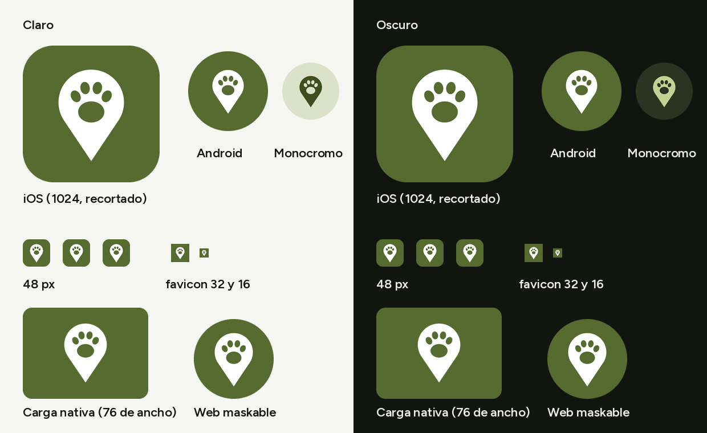
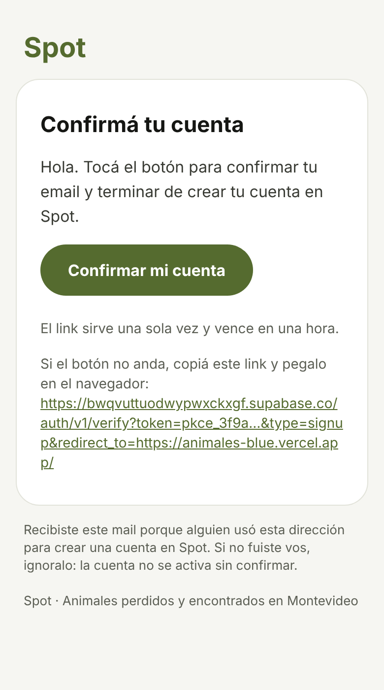

# Spot y preparación para el piloto · 2026-10-21

## 1. Resumen

**Qué se pidió:** ocho cosas, sin agregar funciones fuera de ellas, partiendo de `main` actualizado (`313f0f3`) y sin aplicar nada en producción.

| Pedido | Resultado |
| --- | --- |
| 1. Nombre nuevo: Spot | **Hecho.** La app, la pestaña, la pantalla de carga, el manifest, la vista previa del link, los términos y la privacidad, `app.json` y los mails dicen Spot. Hay un solo `NOMBRE` en `es-UY.ts`. Como los términos nombran la app, la versión sube a `2026-10-21` (migración 0021). Cambiaron también el `slug`, el esquema y los identificadores nativos (abajo, "Identificadores nativos"). Lo que queda con el nombre viejo, a propósito, está en la sección 5. |
| 2. Ícono provisorio | **Hecho.** Un pin de mapa blanco con una huella calada, sobre el oliva `primario`. Lo dibuja el script que ya existía (`scripts/iconos-web.py --provisorio`): `icon.png` de 1024, los de Android, la pantalla de carga nativa, el maskable, 192, 512, `apple-touch-icon` y el favicon. Cómo reemplazarlo: `docs/DISENO.md`, 5.1. |
| 3. Plantillas de mail | **Hecho.** Confirmar la cuenta, recuperar la contraseña, cambiar el email y enlace mágico, en `supabase/templates/`, con el asunto en el `<title>` y en `config.toml`. Un script arma el JSON para cargarlas (sección 4). |
| 4. Clave publishable | **Hecho.** `EXPO_PUBLIC_SUPABASE_PUBLISHABLE_KEY`, con la anon de respaldo. Verificado en la documentación de Supabase y en el código de supabase-js 2.118 (abajo). |
| 5. Mensajes (M20) | **Hecho:** se pide solo lo nuevo, con sondeo. Con 100 mensajes, cada pedido sin novedades pasa de 32.123 a 348 bytes. |
| 6. Captcha (B32) | **Hecho.** Cloudflare Turnstile en registrarse, ingresar y recuperar la contraseña, opcional con `EXPO_PUBLIC_TURNSTILE_SITE_KEY`. Google no lo lleva. Probado en Chromium con un Turnstile simulado, también con los navegadores de WhatsApp e Instagram. |
| 7. Contacto de la familia al cerrar (B10) | **Hecho.** Migración 0022, con `supabase/tests/contacto_al_cerrar.sql`. |
| 8. Vista previa (B37) | **Hecho.** Un color con números no se usa. |

**Lo que se hizo en producción:** nada que cambie algo. Solo lecturas:
- la configuración de Auth, para que los mails digan bien cuánto dura el link: una hora (`mailer_otp_exp` 3600) y cambio de email con confirmación de las dos direcciones;
- los tipos de claves: ya hay una publishable `default`;
- cuántos casos cerrados tienen contacto: ninguno.

### Capturas

El ícono, en claro y en oscuro: grande con las esquinas de iOS, el adaptativo y el monocromo de Android, a 48 px, el favicon, la pantalla de carga nativa y el maskable de la web.



El mail de confirmar la cuenta, a 390 de ancho (con un link de ejemplo en lugar de `{{ .ConfirmationURL }}`):



### Identificadores nativos

- **Qué cambió:** `slug` `encontrados-mvd` → `spot-mvd`; esquema `encontrados` → `spotmvd`; `uy.encontrados.app` → `uy.spotmvd.app` en iOS y en Android.
- **Por qué no rompe nada:**
  - no hay ninguna app publicada, ni proyecto de EAS (`app.json` no tiene `projectId`), ni carpetas `android/` o `ios/`;
  - una vez en las tiendas, el identificador ya no se puede cambiar: conviene hacerlo ahora;
  - el esquema no es `spot` a secas, porque es fácil que otra app lo use (B33).
- **Lo único que toca afuera:** las Redirect URLs de Supabase Auth (`spotmvd://**` en lugar de `encontrados://**`). Solo las usa la app nativa; la web no cambia (sección 4).

### Clave publishable: lo que se verificó

La red de la sesión no llega a supabase.com ni a cloudflare.com, así que la documentación se leyó de sus fuentes en GitHub (`supabase/supabase`, `supabase/auth` y `cloudflare/cloudflare-docs`).

- **Guía de claves de Supabase:**
  - la publishable se pasa a `createClient` en lugar de la anon;
  - "Send publishable and secret keys on the `apikey` header, not on `Authorization: Bearer`", porque no son JWT;
  - la anon se depreca a fin de 2026;
  - el anuncio agrega que en `Authorization` se acepta solo si es igual a `apikey`.
- **supabase-js 2.118:** detecta las claves nuevas (`isNewApiKey`). Sin sesión, manda la clave en `apikey` y también como Bearer, que es justo el caso que Supabase acepta. Con sesión, manda el token de la persona.
- **La vista previa:** con la publishable manda solo `apikey`; con la anon, `apikey` y `Authorization`, como antes. Las dos formas tienen prueba.
- **Las sesiones guardadas no se pierden:** su clave sale de la URL del proyecto, no de la clave pública.

### Captcha: lo que se verificó

- **Qué pedidos lo exigen:** en el código de Supabase Auth (`internal/api/api.go` y `middleware.go`), el captcha se exige en:
  - `/signup` (registrarse);
  - `/token` con contraseña (ingresar);
  - `/recover` (recuperar la contraseña);
  - `/resend`, `/otp` y `/magiclink`, que la app no usa.

  No se exige para OAuth (Google), al refrescar la sesión ni al cambiar la contraseña.
- **Cómo lo manda la app:** el token va como `captchaToken`.
- **Turnstile:**
  - render explícito (`api.js?render=explicit`);
  - claves de prueba `1x00000000000000000000AA` (pasa siempre) y `2x00000000000000000000AB` (falla siempre);
  - cada token dura 300 segundos y sirve una sola vez;
  - Cloudflare avisa que las WebViews y los navegadores internos pueden tener menos funciones.

### M20: por qué sondeo con lo nuevo y no Realtime

- **Sondeo con lo nuevo:**
  - la primera vez pide todo;
  - después pide `created_at >= último - 10 s` y suma lo que llega sin repetir ids (`src/features/mensajes/incremental.ts`);
  - el margen cubre dos mensajes casi simultáneos que se guardan en otro orden;
  - al marcar los mensajes como leídos, se anotan también en la caché, porque los viejos ya no se vuelven a pedir.
- **Realtime:** no suma peso, porque supabase-js ya lo trae, pero:
  - pide una migración (`mensajes` en la publicación `supabase_realtime`);
  - la base evalúa la RLS de cada cambio por cada suscripción;
  - hay que reconectar y volver a pedir lo perdido, algo que el sondeo ya hace;
  - sin sesión, las conexiones duran 24 horas.

  Para el piloto, el sondeo alcanza y no toca la base.

**Medición:** conversación de 100 mensajes (seis textos de 6 a 104 caracteres, que se repiten), con la misma consulta y la misma forma JSON que devuelve PostgREST (`json_agg` de `mensajes_detalle`), en el Postgres local. Son solo los cuerpos de las respuestas; los encabezados son iguales antes y después.

| Cada pedido (cada 4 s) | Antes: toda la conversación | Después, sin novedades | Después, con un mensaje nuevo |
| --- | --- | --- | --- |
| Mensajes | 100 | 1 (el último, por el margen) | 2 |
| Bytes | 32.123 | 348 | 656 |
| Con gzip | 3.749 | 237 | 332 |
| Por minuto (15 pedidos) | 470 KB (55 KB con gzip) | 5,1 KB (3,5 KB con gzip) | — |

Con gzip, el "antes" sale muy chico porque los textos se repiten. Con mensajes reales comprime menos.

## 2. Cambios

### Nombre (Spot)

- `src/i18n/es-UY.ts`:
  - el nombre en una constante, `NOMBRE`;
  - el lema: "Animales perdidos y encontrados en Montevideo";
  - el título de la pestaña, los textos de compartir y de la vista previa, instalar, reportar un error, los términos y la privacidad;
  - textos nuevos del captcha.
- `public/index.html`: la pantalla de carga y el aviso sin JavaScript. El `<title>` sale de `app.json`.
- `public/manifest.webmanifest`: nombre y nombre corto.
- `app.json`:
  - el nombre, el `slug`, el esquema y los identificadores nativos;
  - los textos de los permisos;
  - el `backgroundColor` del ícono adaptativo, en el `primario`;
  - sin el `.icon` de la plantilla de Expo, así iOS usa `icon.png`.
- `assets/expo.icon/`: borrado (el logo de Expo para iOS).
- `package.json` y `package-lock.json`: el nombre del paquete, `spot-mvd`.
- `src/features/legal/terminos.ts`: `VERSION_TERMINOS = '2026-10-21'`.
- `supabase/migrations/20261021000021_terminos_spot.sql` (nueva): `terminos_version` pasa a `2026-10-21`.
- `src/components/auth/Acceso.tsx`: el comentario del encabezado.
- `src/features/auth/acciones.ts`: el comentario del esquema nativo (`spotmvd://auth/callback`). La URL la arma `Linking.createURL` con el esquema de `app.json`.
- `api/vista-previa.ts`: el user agent con el que pide su `index.html`, `spot-vista-previa`.
- `supabase/config.toml`: `site_url` y Redirect URLs locales con `spotmvd://`.

### Ícono

- `scripts/iconos-web.py`:
  - `--provisorio` dibuja el pin con la huella con Pillow, con supermuestreo, en los colores de `tema.ts` (con su token en un comentario);
  - sin la opción, como antes: de `icon.png` salen los de la web y, ahora, también el favicon.
- `assets/images/`: `icon.png` (1024, sin transparencias), `android-icon-foreground.png`, `android-icon-background.png`, `android-icon-monochrome.png`, `splash-icon.png` y `favicon.png`.
- `public/iconos/`: `icono-192.png`, `icono-512.png`, `icono-maskable-512.png` y `apple-touch-icon.png`.

### Mails

- `supabase/templates/`:
  - `confirmacion.html`, `recuperacion.html`, `cambio_email.html` y `enlace_magico.html`: tablas, estilos en línea, sin imágenes ni fuentes externas, paleta clara, voseo y sin el nombre público;
  - `README.md`: cuándo se manda cada una y cómo se cargan.
- `supabase/config.toml`: `[auth.email.template.*]` con asunto y archivo.
- `scripts/plantillas-mail.js` (nuevo): el JSON para la API de gestión.

### Clave publishable

- `src/lib/env.ts`: `elegirClave` (la publishable o la anon) y `esClaveNueva`; `ENV.supabaseKey` reemplaza a `supabaseAnonKey`. También `ENV.turnstileSiteKey`.
- `src/lib/supabase.ts`: usa `ENV.supabaseKey`.
- `api/vista-previa.ts`: `encabezadosDeLectura`, que manda la publishable solo en `apikey`.
- `.env.example`: las variables nuevas, explicadas.

### Mensajes (M20)

- `src/features/mensajes/incremental.ts` (nuevo):
  - `desdeParaPedir`, el último menos 10 s;
  - `sumarMensajes`, por id y en orden;
  - `marcarLeidosEnCache`;
  - `milisegundos`, que lee las fechas de Postgres con microsegundos sin depender del motor.
- `src/features/mensajes/api.ts`:
  - `listarMensajes(id, desde)` con `gte`;
  - `useMensajes` suma lo nuevo a lo que tenía;
  - `anotarLeidos`.
- `src/app/conversacion/[id].tsx`: después de marcar leídos, los anota en la caché.

### Captcha (B32)

- `src/features/auth/captcha.ts` (nuevo):
  - `claveCaptcha`: solo en web y con la clave;
  - `CLAVE_CAPTCHA`;
  - `opcionesCaptcha`: el token, o un error en español si falta.
- `src/features/auth/useCaptcha.ts` (nuevo): el token de la pantalla y `reiniciar`, después de cada intento.
- `src/components/auth/Captcha.tsx` (nuevo): en nativo, nada.
- `src/components/auth/Captcha.web.tsx` (nuevo): Turnstile.
  - Baja el script de Cloudflare solo al montarse y una sola vez.
  - Render explícito en el elemento del DOM del `View`, con el tema de la app, en español y a todo el ancho.
  - Si vence o falla, el token queda en null; si el script no carga, un mensaje con Reintentar.
  - `reset` en cada reinicio.
- `src/features/auth/acciones.ts`: `ingresarConEmail`, `registrarse` y `pedirRecuperacion` reciben el token y lo mandan como `captchaToken`; un `captcha_failed` al recuperar da el mensaje del captcha.
- `src/features/auth/validaciones.ts`: `traducirError` reconoce `captcha_failed`.
- `src/app/auth/ingresar.tsx`, `registrarse.tsx` y `recuperar.tsx`: el captcha arriba del botón y, después de cada intento, otro token. En Ingresar, Google no lo usa.

### Contacto al cerrar (B10)

- `supabase/migrations/20261021000022_contacto_al_cerrar.sql` (nueva):
  - el trigger `animales_contacto_al_cerrar` (`before update of estado`, función `vaciar_contacto_al_cerrar`) vacía `contacto_familia` al pasar a reunido o vinculado;
  - también vacía el de los casos que ya estaban cerrados.
- `supabase/tests/contacto_al_cerrar.sql` (nueva): siete comprobaciones (ver sección 3).
- `supabase/tests/README.md`: la prueba nueva y migraciones 0001 a 0022.

### Vista previa (B37)

- `src/lib/compartir.ts`: `colorParaCompartir` deja afuera un color con algún dígito. Va en `datosParaCompartir`, que usan la vista previa y el texto de compartir: así tampoco viaja en el mensaje de WhatsApp.

### Pruebas de jest

- **Nuevas:**
  - `__tests__/env.test.ts`: qué clave se usa;
  - `captcha.test.ts`: clave por plataforma, opciones, error en español y `captcha_failed`;
  - `mensajesIncremental.test.ts`: fechas, margen, suma sin duplicados, orden y leídos;
  - `marca.test.ts`:
    - el nombre y los colores de `app.json`;
    - los colores del script del ícono;
    - las cuatro plantillas: asunto igual al `<title>` y a `config.toml`, link, nada externo, sin `.Data`, solo colores de la paleta clara;
    - `VERSION_TERMINOS` igual a la última migración.
- **Cambiadas:**
  - `compartir.test.ts`: B37 y el nombre;
  - `vista-previa.test.ts`: B37, los headers con la anon y con la publishable, y el nombre;
  - `indexHtml.test.ts`: el aviso sin JavaScript;
  - `entorno.ts` y `historialHojas.test.ts`: `spot.test` como sitio de ejemplo.

### Documentación

- `README.md`: variables, migraciones 0001–0022, Redirect URLs, mails, captcha, scripts, qué probar y estructura.
- `AGENTS.md`:
  - excepciones de colores y textos (`app.json`, script del ícono y plantillas);
  - reglas de claves y captcha, y los mensajes que piden solo lo nuevo;
  - estructura y fases.
- `docs/ARQUITECTURA.md`: piezas, compartir, vista previa, Hablar, Cuenta (captcha y mails), modelo de datos (`contacto_familia`), RPC, seguridad (claves, captcha, mails), instalar, despliegue y pruebas.
- `docs/DECISIONES.md`:
  - ocho entradas nuevas: el nombre, el ícono, los mails, la publishable, los mensajes, el captcha, el contacto al cerrar y el color con números;
  - una nota en "Sondeo solo con la pantalla a la vista" y otra en "Instalar la app".
- `docs/DISENO.md`: 5.1 "Ícono de la app", el captcha en 7.7, 7.10, 7.11 "Mails" y la sección 10.
- `docs/PRUEBAS-MANUALES.md`:
  - marca [Captcha];
  - mails en los pasos 1 y 20;
  - mensajes nuevos en el 12;
  - contacto en el 18;
  - paso nuevo 27, "Spot y el piloto".

**`src/types/database.ts` no cambia:** la 0021 solo actualiza un valor y la 0022 suma una función de trigger, que no aparece en los tipos (tampoco las demás).

## 3. Verificaciones

| Comando | Resultado |
| --- | --- |
| `npm run typecheck` | Sin errores. |
| `npm run lint` | Sin errores ni avisos. |
| `npm run test` | 23 suites, **233 pruebas pasan** (197 antes; 36 nuevas). |
| `npx expo export -p web` | `Exported: dist`, sin errores. |
| `deno test --allow-env` (en `supabase/functions/reconocer`) | 66 pruebas pasan. `deno lint` y `deno fmt --check`, sin errores. La función no cambió. |

**Pruebas SQL**, en Postgres 16 local con las migraciones 0001 a 0022:
- **Resultado:** pasan las diez, de a una, con el seed y en una base vacía: `fase5_permisos`, `fase6_perdidos`, `fase7_cuenta`, `fase8_casos`, `fase9_revision`, `fase9_parte2`, `errores`, `vision`, `reconocimiento_ia` y `contacto_al_cerrar`.
- **Control:** sin la 0022, `contacto_al_cerrar.sql` falla donde corresponde ("FALLA 3: el caso reunido conserva el contacto").
- **`contacto_al_cerrar.sql`** comprueba:
  - al resguardarlo y al editar el caso abierto, el contacto sigue;
  - al marcarlo como reunido, se vacía, también en `animales_detalle`;
  - al reabrirlo, no vuelve, y la familia lo puede cargar de nuevo;
  - un cambio sin estado no lo toca;
  - al quedar vinculado, se vacía;
  - no queda ningún caso cerrado con contacto.

**En el navegador,** con Chromium contra el Supabase simulado: dos builds, uno con la publishable y la clave de Turnstile y otro solo con la anon. Turnstile simulado con su misma API, porque desde acá no se llega a Cloudflare. Pasan las 32 comprobaciones:
- **Inicio:** no baja el script de Turnstile, y la pestaña dice "Spot · Animales perdidos y encontrados en Montevideo".
- **Ingresar:**
  - baja el script una vez y dibuja el widget con la clave, en tema claro, en español y a todo el ancho;
  - manda `gotrue_meta_security.captcha_token` y la publishable en `apikey`;
  - con la contraseña mal, muestra el error en español, pide otro token y el segundo intento va con el nuevo.
- **Sin token:** avisa y no manda nada. **Script bloqueado:** el error con Reintentar.
- **Navegador de WhatsApp, en oscuro:** el widget en tema oscuro.
- **Navegador de Instagram:** registrarse manda el token y la versión `2026-10-21` de los términos.
- **Recuperar la contraseña:** manda el token.
- **Sin la clave de Turnstile:** no hay captcha y el pedido es el de antes, con la anon en `apikey` y `Authorization`.
- **Conversación de 100 mensajes:**
  - la primera vez pide todo;
  - después, `created_at=gte.<último - 10 s>` cada 4 s;
  - marca como leídos una sola vez;
  - el mensaje nuevo aparece sin perder los anteriores, y también se marca como leído.

**Carga inicial:** lo nuevo de la app que entra en el bloque común (`__common`) suma unos 4 KB sin comprimir: el componente y la lógica del captcha (unos 3 KB) y `incremental.ts` (1 KB). El script de Cloudflare no está en la carga inicial: se baja al abrir esas tres pantallas, y solo con la clave configurada.

## 4. Pasos manuales

En este orden. Nada de esto se hizo.

### 1. Antes de mergear: aplicar 0021 y 0022 y correr las pruebas

**Por qué antes:** la app nueva acepta los términos `2026-10-21`. Con la base vieja, aceptar falla con "Los términos cambiaron". Entre aplicar la 0021 y el deploy, la app vieja tampoco puede aceptar: conviene que sean pocos minutos.

Con la CLI:
```bash
npx supabase link --project-ref bwqvuttuodwypwxckxgf
npx supabase db push
```

O en el SQL Editor, cada archivo entero, de a uno, y después:
```sql
insert into supabase_migrations.schema_migrations (version, name) values
  ('20261021000021', 'terminos_spot'),
  ('20261021000022', 'contacto_al_cerrar');
```

Comprobar:
```sql
select count(*), max(version) from supabase_migrations.schema_migrations;  -- 22 y 20261021000022
select valor from config_app where clave = 'terminos_version';            -- 2026-10-21
select tgname from pg_trigger where tgname = 'animales_contacto_al_cerrar';
```

Después, las diez pruebas de `supabase/tests/`, de a una, incluida `contacto_al_cerrar.sql`. Cada una termina en `Success. No rows returned`.

### 2. Vercel: la clave publishable

1. En Supabase, **Settings → API Keys**: copiá la **Publishable key** (`default`, empieza con `sb_publishable_`).
2. En Vercel, proyecto **animales** → **Settings → Environment Variables → Add**:
   - **Key:** `EXPO_PUBLIC_SUPABASE_PUBLISHABLE_KEY`;
   - **Value:** la clave del paso 1;
   - **Environments:** Production, Preview y Development.
3. **Dejá `EXPO_PUBLIC_SUPABASE_ANON_KEY` como está:** es el respaldo.

Con la CLI de Vercel, lo mismo es `npx vercel env add EXPO_PUBLIC_SUPABASE_PUBLISHABLE_KEY production` (y `preview`), pegando el valor cuando lo pide.

La variable entra en el próximo build. Si la cargás antes de mergear, el deploy del merge ya la usa. La versión de hoy la ignora.

### 3. Mergear el PR

Vercel despliega solo. Comprobá el deploy en **READY** y que la pestaña diga "Spot".

### 4. Mails: cargar las plantillas

Desde la raíz del repo, con un token personal de supabase.com (**Account → Access Tokens**). No lo guardes en ningún archivo.

```bash
node scripts/plantillas-mail.js > /tmp/plantillas.json
read -rs SUPABASE_ACCESS_TOKEN && export SUPABASE_ACCESS_TOKEN
curl -sS -X PATCH "https://api.supabase.com/v1/projects/bwqvuttuodwypwxckxgf/config/auth" \
  -H "Authorization: Bearer $SUPABASE_ACCESS_TOKEN" \
  -H "Content-Type: application/json" \
  --data-binary @/tmp/plantillas.json > /dev/null && echo cargadas
unset SUPABASE_ACCESS_TOKEN
```

O a mano en **Authentication → Emails → Templates**: asunto y HTML de cada archivo.

**Probar:** pedí "¿Olvidaste tu contraseña?" con una cuenta tuya. Llega "Elegí una contraseña nueva para Spot", en español.

**Remitente:** hoy es "Spot Avisos" (**Authentication → Emails → SMTP Settings → Sender name**). Si querés que diga solo "Spot", cambialo ahí.

### 5. Redirect URLs (para la app nativa; no apura)

En **Authentication → URL Configuration → Redirect URLs**:
- agregá `spotmvd://**`;
- borrá `encontrados://**`.

La web no las usa.

### 6. Captcha: primero la app, después Supabase

**El orden importa:** si se activa en Supabase antes de que la app mande el token, nadie puede registrarse, ingresar con email ni recuperar la contraseña.

1. **Cloudflare (gratis):**
   - en [dash.cloudflare.com](https://dash.cloudflare.com), con una cuenta de Cloudflare, andá a **Turnstile → Add widget**;
   - **Widget name:** `Spot`;
   - **Hostname management:** `animales-blue.vercel.app` (y `localhost`, si querés probar en tu computadora);
   - **Widget mode:** Managed;
   - **Pre-clearance:** No;
   - **Create.** Copiá la **Site Key** (pública) y la **Secret Key** (secreta).
2. **Vercel:** **Settings → Environment Variables → Add**, `EXPO_PUBLIC_TURNSTILE_SITE_KEY` con la Site Key, en Production (y Preview, si agregaste esos hostnames). Después, **Deployments → el último de producción → Redeploy**: la variable va dentro del build.
3. **Comprobar en la web publicada:**
   - **Ingresar** muestra la comprobación de Cloudflare arriba del botón y deja ingresar;
   - lo mismo en **Crear cuenta** y **¿Olvidaste tu contraseña?**;
   - desde el navegador de WhatsApp (paso 27 de `docs/PRUEBAS-MANUALES.md`).

   Hasta el paso 4, Supabase ignora el token.
4. **Supabase:**
   - andá a **Authentication → Attack Protection** (`https://supabase.com/dashboard/project/bwqvuttuodwypwxckxgf/auth/protection`; en la documentación figura como Bot and Abuse Protection);
   - **Enable CAPTCHA protection**;
   - en el proveedor elegí **Turnstile**: hoy dice hCaptcha;
   - pegá la **Secret Key** y **Save**.
5. **Comprobar de nuevo:** ingresar, crear una cuenta y recuperar la contraseña.
   - Con Google sigue sin captcha.
   - Si algo falla, apagá **Enable CAPTCHA protection** primero; la variable de Vercel puede quedar.

**Para volver atrás:** primero se apaga en Supabase; después, si querés, se borra la variable y se redespliega.

### 7. Recorrer a mano

En `docs/PRUEBAS-MANUALES.md`: los pasos 1, 12, 18, 20 y 27, en Android con Chrome, iPhone con Safari y una computadora.

## 5. Pendientes y riesgos

- **El captcha real no se probó:** desde la sesión no se llega a Cloudflare. Se probó la integración con un Turnstile simulado con la misma API. Falta el paso 27 en celulares reales, sobre todo en los navegadores de WhatsApp e Instagram: Cloudflare avisa que las WebViews pueden tener menos funciones. Si en alguno falla, ahí no se puede ingresar con email, y Google tampoco anda en los navegadores de Instagram y Facebook (B19). La salida es abrir el link en Chrome o Safari, como ya explica "Instalar la app" en esos navegadores.
- **Previews de Vercel con captcha:** si el hostname de la preview no está en el widget, la comprobación falla ahí. Con el captcha activado en Supabase, en esa preview no se puede ingresar con email.
- **App nativa:** no tiene widget de Turnstile (pide una WebView). Con el captcha activado en Supabase, una app nativa no podría ingresar con email. Hoy no hay ninguna publicada; antes de publicarla, hay que sumarlo.
- **Términos:** cambian de versión por el nombre. Todas las cuentas los vuelven a aceptar antes de publicar, escribir o denunciar. Hoy son 4.
- **Mails:**
  - Gmail como SMTP tiene su propio tope diario de envíos (el de la cuenta de Google), aparte de los 30 por hora de Supabase;
  - algunos correos (Outlook con Safe Links) abren el link antes que la persona y lo gastan; la app muestra "Este link ya no sirve…" y deja pedir otro.
  - La app no ofrece cambiar el email: esa plantilla queda lista para cuando se use, o si se cambia desde el panel.
- **Mensajes:**
  - cada pedido vuelve a traer el último mensaje (el margen de 10 s): unos 350 bytes;
  - si un pedido llega justo mientras se marcan los leídos, puede marcarlos dos veces, sin efecto.
- **Clave anon:** antes de desactivar las claves legacy en Supabase, hay que cambiar Vercel (sección 4, paso 2) y confirmar que la función `reconocer` usa la secreta nueva. La función ya la prefiere (`SUPABASE_SECRET_KEYS`).
- **Ícono:** es provisorio y se hizo con geometría simple. El definitivo se reemplaza como dice `docs/DISENO.md`, 5.1.
- **Lo que queda con el nombre viejo, a propósito:**
  - **"encontrados" como palabra:** el tipo de reporte (el chip "Encontrados" y los textos "tus encontrados abiertos"), no es el nombre.
  - **Claves de `localStorage`:** `encontrados-apariencia` y `encontrados-hoja-cerca` (`preferencia.ts`, `preferenciaHoja.ts` y el script de `index.html`). Cambiarlas borra la apariencia y la posición de la hoja que cada persona eligió.
  - **Ids internos:** `encontrados-fuentes`, `-carga` y `-web` en `index.html`, `fuentesWeb.ts` y su prueba, y la marca `hojaEncontrados` del historial (`historialHojas.ts`). Nadie los ve.
  - **La función `reconocer`:** el user agent `encontrados-reconocer` y el texto que le manda a la API ("para Encontrados"). Cambiarlo pide desplegarla de nuevo; conviene hacerlo la próxima vez que se toque.
  - **La cuenta demo:** `demo@encontrados.uy` (`seed.sql` y README). Es la cuenta que existe en producción.
  - **Pruebas SQL:** los emails `@encontrados.test` de las personas de prueba.
  - **El servicio sin desplegar** (`services/vision`): nombres de recursos de Google Cloud.
  - **Lo histórico, que no se toca:** las migraciones aplicadas, los reportes viejos y las decisiones viejas de `docs/DECISIONES.md`.
- **El reconocimiento:** sigue como quedó en su cierre. Este trabajo no lo toca.
