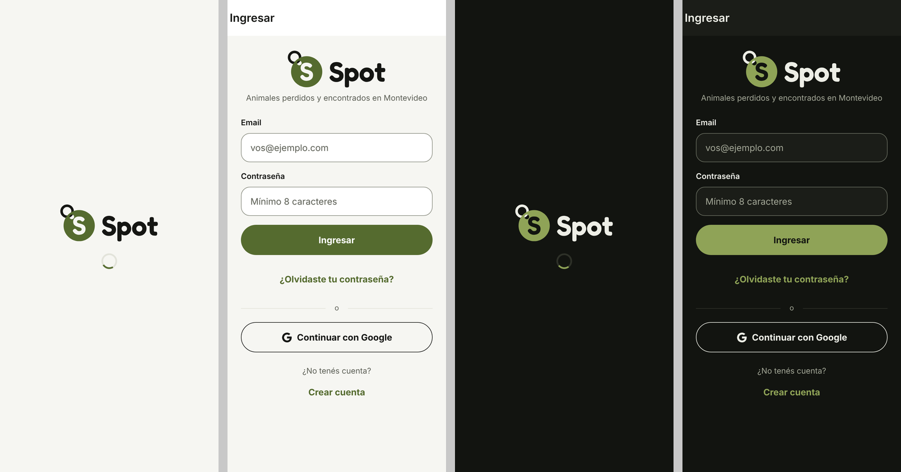

# Spot: el logo · 2026-10-21

## 1. Resumen

**El pedido:** el nombre visible Spot y el logo nuevo, una chapita de collar con una S, con los archivos finales en `spot-logo/`. Había que usarlos tal cual, en los íconos, en Ingresar y Registrarse, en la pantalla de carga web y en la vista previa, con la documentación y las pruebas.

**Lo que ya estaba hecho:** el nombre se había cambiado en el PR #15 (mergeado y en producción): `app.json` (nombre y permisos), el manifest, `index.html`, `es-UY.ts`, la vista previa del link, los términos y los docs. También `adaptiveIcon.backgroundColor` en `#556B2F`, `ios.icon` y el borrado de `assets/expo.icon/`. Lo que quedaba era el logo: eso es lo que se hizo acá.

### Los archivos

Copiados a `spot-logo/` desde el zip, comprobados y movidos a su lugar. Después se borró la carpeta. Todos llegaron como archivos, y sus medidas coinciden con `LEEME.md`:

| Archivo                                               | Medida           | `LEEME.md`  |
| ----------------------------------------------------- | ---------------- | ----------- |
| `assets-images/icon.png`                              | 1024 × 1024, RGB | 1024 ✓      |
| `assets-images/android-icon-foreground.png`           | 512 × 512, RGBA  | 512 ✓       |
| `assets-images/android-icon-background.png`           | 512 × 512, RGB   | 512 ✓       |
| `assets-images/android-icon-monochrome.png`           | 432 × 432, RGBA  | 432 ✓       |
| `assets-images/favicon.png`                           | 48 × 48, RGBA    | 48 ✓        |
| `assets-images/splash-icon.png`                       | 228 × 244, RGBA  | 228 × 244 ✓ |
| `public-iconos/icono-192.png`                         | 192 × 192        | ✓           |
| `public-iconos/icono-512.png`                         | 512 × 512        | ✓           |
| `public-iconos/icono-maskable-512.png`                | 512 × 512        | ✓           |
| `public-iconos/apple-touch-icon.png`                  | 180 × 180        | ✓           |
| `svg/spot-logo.svg` y `spot-logo-oscuro.svg`          | 274 × 107        | ✓           |
| `svg/spot-marca.svg`, `-oscuro`, `-negro` y `-blanco` | 316 × 337        | ✓           |
| `svg/spot-icono.svg`                                  | 1024 × 1024      | ✓           |

**`public/iconos/`:** `scripts/iconos-web.py`, corrido sobre el `icon.png` nuevo en una carpeta aparte, da los cuatro **byte por byte iguales** a los que llegaron.

### Diferencias con el pedido

- **`favicon.png` no sale de `icon.png`.** Es un dibujo propio para 48 px, con las esquinas redondeadas y la chapita más grande. Se usó el que llegó, y el script ya no lo genera: si no, lo pisaba.
- **`splash-icon.png` cambia de medida.** Pasa de 250 × 348 (el provisorio) a 228 × 244, que es lo que dice `LEEME.md`. `app.json` lo muestra a 76 de ancho, así que no hubo que tocarlo.
- **Los identificadores nativos ya no dicen "encontrados".** El pedido los listaba entre lo que no cambia (`slug`, `scheme` `encontrados://`, `bundleIdentifier`, `package`, el `name` de `package.json`). Ya se habían cambiado en el PR #15, a `spot-mvd`, `spotmvd` y `uy.spotmvd.app`, con su decisión en `DECISIONES.md`. La Redirect URL de producción ya es `spotmvd://**`. No se tocaron, ni se volvieron atrás. Los que todavía dicen "encontrados" quedan así y están listados en `DECISIONES.md`.
- **El lema.** "Spot · Animales perdidos y encontrados en Montevideo" ya era el título de la pestaña (`t.app.tituloWeb`). Debajo del logo sigue el lema sin el nombre (`t.app.lema`), porque el logo ya dice "Spot" justo arriba.
- **La vista previa no cambia.** No usa ninguna imagen genérica: cada caso tiene foto (es obligatoria), y la vista previa genérica (caso que no existe u oculto) va sin `og:image`.
- **El flujo de pruebas manuales es el 28.** El 26 ya existía (reconocimiento con la IA).
- **El logo en la app es el SVG.** Metro lo toma como recurso y `expo-image` lo muestra en Android, iOS y web, así que no hicieron falta los PNG @1x, @2x y @3x.

### El logo en la app

- **Ingresar y Registrarse** (`MarcaAcceso`, en `Acceso.tsx`):
  - el logo completo, de 180 × 70: `spot-logo.svg` en claro y `spot-logo-oscuro.svg` en oscuro;
  - el logo es el encabezado de la pantalla, con el nombre accesible "Spot", prioridad alta y sin carga diferida;
  - en web queda `<h1></h1>`: el lector lo encuentra como encabezado "Spot" y como imagen "Spot";
  - en nativo es un solo elemento, "Spot", con el rol de encabezado.
- **Pantalla de carga web:**
  - el logo en SVG en línea, con las mismas formas del archivo (generado por script desde `spot-logo.svg`, sin tocar los trazados) y sin colores propios;
  - el CSS pinta la chapita con `--carga-primario` y la argolla y la palabra con `--carga-texto`. Esas variables ya cambian con el esquema elegido y son, justo, los colores de cada archivo;
  - en el navegador da `#556B2F` y `#151613` en claro, y `#8FA357` y `#EDEEE6` en oscuro.



### Un problema en los archivos: el ícono adaptativo de Android

El dibujo de `android-icon-foreground.png` (y del monocromo) llega al 76,5 % del radio. Android garantiza solo el círculo de 66 de 108 dp (61 %) y muestra como mucho 72 de 108 (66,7 %). En un lanzador con máscara redonda se corta el borde de la argolla:


A la izquierda, la capa entera, con la zona segura (azul) y lo que se ve (rojo). A la derecha, con la máscara redonda.

- **Hoy no afecta a nadie:** solo lo usa la app nativa, que todavía no se publica.
- **La web instalada no tiene el problema:** usa `icono-maskable-512.png`, cuyo dibujo entra en el círculo del 80 %.
- **No se tocó,** porque el pedido era usar los archivos tal cual (sección 5).

## 2. Cambios

**Íconos y logo**

- `assets/images/` (`icon.png`, `android-icon-foreground.png`, `android-icon-background.png`, `android-icon-monochrome.png`, `favicon.png`, `splash-icon.png`): reemplazados por los del logo.
- `public/iconos/` (192, 512, maskable y `apple-touch-icon.png`): reemplazados; son los que da el script.
- `assets/marca/` (nuevo): los siete SVG, como fuente oficial.

**Código**

- `scripts/iconos-web.py`:
  - ya no dibuja el ícono provisorio (`--provisorio`, que habría pisado el logo) ni el favicon;
  - solo arma `public/iconos/` desde `icon.png`.
- `src/components/auth/Acceso.tsx`:
  - `MarcaAcceso` muestra el logo con `expo-image`, según el esquema, a 180 de ancho, como encabezado de la pantalla y con el nombre accesible "Spot";
  - deja de usar el texto en Fredoka.
- `src/types/svg.d.ts` (nuevo): el tipo de los `.svg` importados (un número en nativo y `{ uri, width, height }` en web).
- `public/index.html`: el nombre de la pantalla de carga pasa a ser el logo en SVG en línea, con su CSS y el comentario que dice de dónde salen las formas.

**Pruebas**

- `__tests__/indexHtml.test.ts`: una prueba nueva compara el logo de la carga con `spot-logo.svg` y `spot-logo-oscuro.svg`:
  - mismas formas;
  - el nombre accesible;
  - que no tenga colores propios;
  - que cada parte del archivo sea el color que el CSS le da en su esquema.

  La de los textos ahora mira el `aria-label` en vez del `<p>`.

- `__tests__/marca.test.ts`:
  - **el ícono de `app.json`:** es `icon.png` en todas las plataformas, sin `assets/expo.icon`;
  - **los colores de `assets/marca/`:** cada SVG usa los de `tema.ts` de su esquema;
  - **la forma de las versiones:** el logo claro y el oscuro, y las cuatro chapitas, tienen la misma forma;
  - **las medidas de `assets/images/`;**
  - **"Encontrados" en `es-UY.ts`:** solo aparece como la etiqueta sola de la categoría, nunca en una oración. Revisa el código fuente, así también encuentra los textos de dentro de las funciones.

  Sale la prueba de los colores del script, que ya no tiene.

**Docs**

- `docs/DISENO.md`:
  - **5.1, "Ícono de la app":** el definitivo, con sus archivos, medidas y zonas seguras;
  - **5.2, "Logo" (nueva):** archivos, colores, calados, margen libre, tamaños mínimos, usos en la app y qué no hacer;
  - **7.7 y 7.9:** el logo en Ingresar y en la pantalla de carga;
  - **la sección 10.**
- `docs/DECISIONES.md`:
  - entrada nueva, "El logo de Spot: una chapita de collar", con la lista de identificadores técnicos que siguen diciendo "encontrados";
  - notas en las del manifest y del ícono provisorio.
- `docs/PRUEBAS-MANUALES.md`: el flujo 28, "El logo de Spot". En el 27, el ícono y la carga nuevos, y unos 90 minutos en total.
- `AGENTS.md`:
  - la regla de colores cuenta el logo en lugar del script;
  - una regla nueva, "Logo";
  - `assets/` en la estructura;
  - la tarea en las fases.
- `README.md` y `docs/ARQUITECTURA.md`: el script y el ícono, sin el provisorio. En la estructura, `assets/`.
- Este reporte y sus capturas (`docs/reportes/2026-10-21-spot/`).

## 3. Verificaciones

| Comando                          | Resultado                                      |
| -------------------------------- | ---------------------------------------------- |
| `npm run typecheck`              | Sin errores                                    |
| `npm run lint`                   | Sin errores                                    |
| `npm run test`                   | 23 suites, 238 pruebas pasan (5 más que antes) |
| `npx expo export -p web --clear` | Sin errores                                    |

**`--clear`:** sin él, el export local reusaba una caché vieja de Metro, con el manifest de cuando la app se llamaba Encontrados dentro del `entry`. Con la caché limpia no aparece. Producción no tenía el problema: el `entry` publicado no dice "Encontrados" (comprobado en el cierre de hoy).

**`grep -rn "Encontrados" src public api app.json`:** solo encuentra la categoría y un identificador:

- `src/components/mapa/FilaFiltros.tsx:20` y `src/features/reportes/filtros.ts:56`: comentarios sobre el chip "Encontrados";
- `src/i18n/es-UY.ts:95`: la etiqueta del chip;
- `src/lib/historialHojas.ts:17`: `hojaEncontrados`, la marca del historial, que se mantiene.

**Las pruebas nuevas detectan las fallas.** Con el código roto a propósito, falla la que corresponde:

- "avisá en Encontrados" en `es-UY.ts`;
- un número cambiado en un trazado del logo de la carga;
- un color cambiado en `spot-logo-oscuro.svg`.

**En el navegador** (Chromium, 390 × 844, el build exportado contra el Supabase simulado):

- **Ingresar y Registrarse,** en claro y en oscuro, cargan el SVG de su esquema (`image/svg+xml`) a 180 × 70, sin errores.
- **El lector** encuentra un encabezado "Spot" y una imagen "Spot".
- **La pantalla de carga,** sin el JS, muestra el logo de 180 × 70 con los colores de cada esquema.

**Peso**

- `index.html` pasa de 3,4 a 6,2 KB con gzip (el logo en línea), y sigue entrando en el primer viaje.
- El JS crece 407 bytes: las dos referencias a los SVG, en `__common`. Los SVG pesan 5,7 KB cada uno y solo se bajan en Ingresar y Registrarse, el del esquema activo.

**Base y función:** este cambio no toca la base, `supabase/functions/reconocer` ni `services/vision`. No hay pruebas SQL ni de Deno para correr.

## 4. Pasos manuales

**En Supabase y Vercel no hay nada que hacer:** sin migración, sin variables y sin cambios de configuración. Al mergear, Vercel despliega solo.

1. **Recorrer el flujo 28** de `docs/PRUEBAS-MANUALES.md` en Android con Chrome, iPhone con Safari y una computadora.
2. **Quien ya instaló la web sigue un tiempo con el ícono viejo:**
   - **Android:** Chrome revisa el manifest de la app instalada cada tanto, al abrirla, y actualiza el ícono. Puede tardar unos días. Si no cambia, desinstalala y volvé a instalarla.
   - **iPhone:** no lo cambia nunca. Hay que borrarla de la pantalla de inicio y volver a agregarla (**Compartir → Agregar a inicio**).
   - **La pestaña:** el navegador puede tener el favicon viejo en caché. Se arregla recargando la página con caché vacía.
3. **Pedirle a quien hizo el logo** el frente y el monocromo del ícono adaptativo de Android (512 y 432) con el dibujo dentro del círculo de 66 de 108: hoy llega al 76,5 % del radio y tendría que llegar al 61 %. Cuando lleguen:
   ```bash
   cp android-icon-foreground.png android-icon-monochrome.png assets/images/
   npm run test
   ```
   El fondo y `app.json` no cambian.

## 5. Pendientes y riesgos

- **El ícono adaptativo de Android** se corta en los lanzadores con máscara redonda (sección 1). Solo afecta a la app nativa, que todavía no se publica. Hay que arreglarlo antes de las tiendas.
- **Los identificadores nativos:**
  - el pedido los daba por "encontrados", pero son `spotmvd` desde el PR #15 y ya están en producción (la Redirect URL de Supabase);
  - si la idea era otra (por ejemplo, volver a `encontrados://` hasta las tiendas), avisame: volver atrás pide cambiar también la Redirect URL.
- **El lema:** debajo del logo queda sin "Spot ·", para no repetir el nombre. Si lo querés completo también ahí, es cambiar `t.app.lema` por `t.app.tituloWeb` en `MarcaAcceso`.
- **Una imagen para la vista previa genérica:** hoy no lleva. Se podría poner el ícono (`/iconos/icono-512.png`) cuando el caso no existe o está oculto. No se hizo porque el pedido lo pedía solo si ya había una imagen genérica.
- **La pantalla de carga ya no usa Fredoka:** el logo está dibujado en formas. Las fuentes siguen declaradas en `index.html` para la app.
- **La rama:** el PR #16 (el reporte de cierre del PR #15) sigue abierto en esta misma rama, así que este commit se suma a ese PR. Se le actualizaron el título y la descripción.
