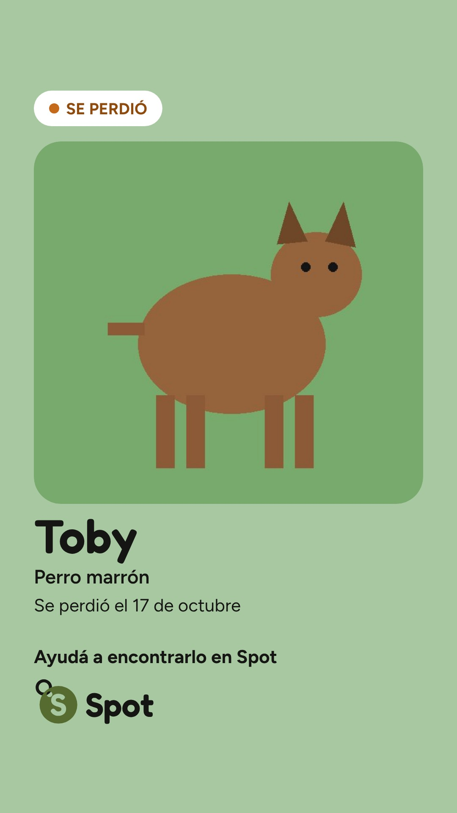
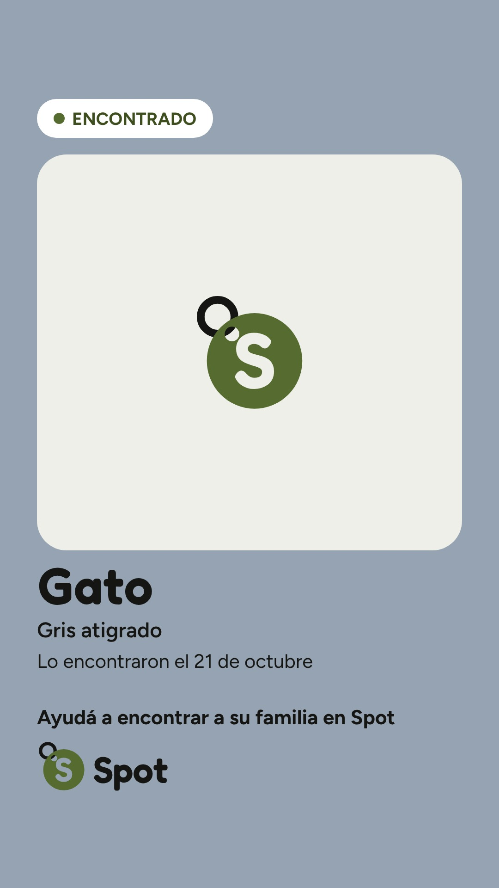
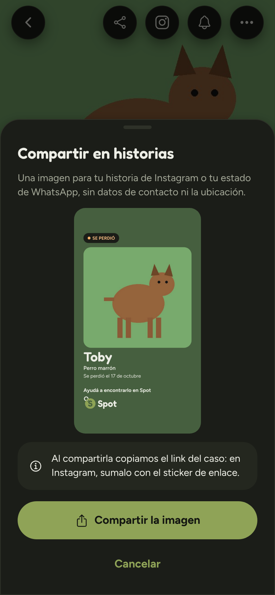
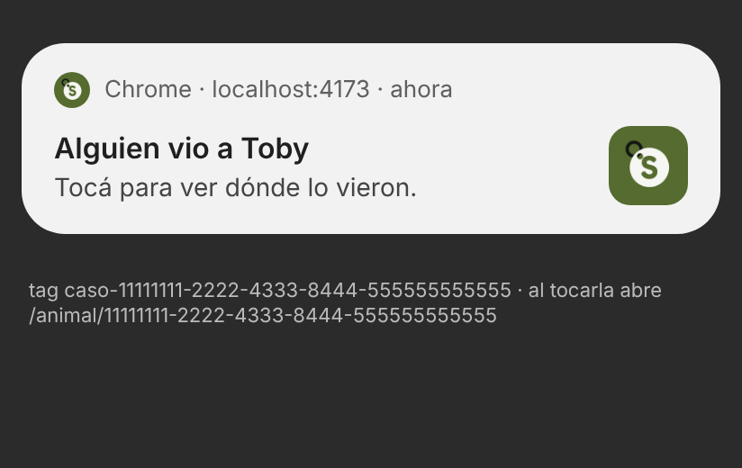

# Notificaciones en el celular e historias de Instagram · 2026-10-22

## 1. Resumen

**El pedido:** dos cosas, desde `main` actualizado y sin aplicar nada en producción.
1. **Notificaciones en el celular (Web Push)** para la web instalada (o no): cada aviso de `notificaciones` (lo vieron, mensaje nuevo, posible coincidencia, cambios de estado, reporte de error resuelto) llega también como notificación. Suscripciones con RLS, una Edge Function `avisar` llamada por la base con `pg_net` y el mismo esquema de secreto que `reconocer`, una librería de Web Push para Deno con licencia permisiva, claves VAPID (la pública en la app, la privada como secreto; generadas y cargadas en el cierre, nunca en archivos), `push` y `notificationclick` en `sw.js` sin caché, el permiso en el momento justo (después de publicar y en Perfil, nunca al abrir), iPhone instalada, navegadores de las apps, permiso bloqueado, nada privado en la pantalla bloqueada, agrupado por caso, un tope por persona y por hora, y bloqueos y casos ocultos como en Actividad. El push nativo de Expo, igual.
2. **Compartir como historia de Instagram:** "Compartir en historias" junto a Compartir, una imagen de 1080 × 1920 armada en el celular con un canvas (fondo con el color dominante de la foto, la foto grande, "SE PERDIÓ" o "ENCONTRADO", el nombre o la especie, la fecha, el logo y "Ayudá a encontrarlo en Spot"; sin contactos ni ubicación), compartida como archivo con `navigator.share` y el link copiado a la vez; si el navegador no puede, descargarla; si la foto no se puede dibujar, el color de la especie.

**Lo que se hizo:** las dos partes, con su migración (0024), la función `avisar`, la app, la documentación y las pruebas (SQL, Deno, jest y e2e). **Nada se aplicó en producción.** Las claves VAPID no se generaron todavía: se generan y cargan en el cierre (sección 4), sin pasar por ningún archivo.

### La historia, en claro y en oscuro

| Claro | Oscuro | Sin foto que se pueda dibujar |
| --- | --- | --- |
|  |  |  |

Son las imágenes que entrega la app (el archivo que recibe `navigator.share`), armadas por el build real en Chromium contra el Supabase simulado, con `e2e/datos/perro.jpg` como foto. La tercera es un encontrado con una foto de otro sitio (`cataas.com`), que no se puede bajar desde acá: sale con el color del gato y la chapita.

La hoja, en oscuro: 

### Una notificación



**No es una captura del sistema:** en este contenedor no hay bandeja de notificaciones. Se entregó un push real al service worker del build (`public/sw.js`) con el protocolo de depuración de Chromium, se leyó lo que mostró (`getNotifications()`: título "Alguien vio a Toby", cuerpo "Tocá para ver dónde lo vieron.", el ícono de Spot, tag `caso-<id>` y la ruta `/animal/<id>`) y se dibujó con esos datos como la muestra Chrome en Android. La de verdad se ve en el paso 30 de `docs/PRUEBAS-MANUALES.md`.

### Cómo funciona

- **Suscribirse:** el permiso se pide con un toque: "¿Querés que te avisemos al celular cuando alguien lo vea?" arriba del caso recién publicado (una vez) o el interruptor "Notificaciones en este celular" en Perfil. `Notification.requestPermission` va en el mismo toque (Safari lo exige). La suscripción se guarda con `guardar_suscripcion_push`, que solo acepta los servicios de push de Chrome, Edge, Firefox y Safari. En iPhone sin instalar explica que llegan con la app instalada y abre los pasos; en los navegadores de WhatsApp, Instagram y Facebook, que hay que abrirla en Chrome o Safari; bloqueadas, cómo volver a permitirlas según el dispositivo. Al cerrar sesión se borra la del navegador.
- **Mandar:** `notificar` sigue igual. Un trigger nuevo pone cada aviso de alguien con suscripciones en `avisos_push` y despierta a `avisar` una vez por transacción. La función le pide a la base qué mandar (`preparar_avisos_push`: nada de lo ya leído, de alguien bloqueado ni de un caso oculto; uno por caso o conversación cada 5 minutos; tope de 6 por persona y por hora), arma el texto, lo cifra para cada navegador y lo firma con VAPID (`@negrel/webpush`, MIT), con `Topic` y TTL de 12 h. El resultado vuelve a la base (`terminar_avisos_push`), que borra las suscripciones vencidas (404 o 410).
- **Textos de la pantalla bloqueada:** "Alguien vio a Toby", "Alguien tiene a Toby a salvo", "¡Toby volvió con su familia!", "Toby se volvió a escapar", "Encontraron un animal parecido a Toby", "Posible coincidencia con el gato", "Tenés un mensaje nuevo sobre Toby", "Llegó un reporte de un error", "Resolvimos el error que reportaste". Sin nombre (o con uno que tiene números, una arroba o un link), la especie. Nunca el nombre de quien lo vio, el texto de un mensaje, contactos ni lugares.
- **En el celular:** `sw.js` muestra la notificación con un tag por caso o conversación (la nueva reemplaza a la anterior sin volver a sonar) y al tocarla lleva la app abierta a esa pantalla o abre una. Solo sigue rutas de la app.

**Decisiones que vale mirar** (detalle en `docs/DECISIONES.md`, "Notificaciones en el celular (Web Push)" y "Compartir en historias"):
- **Casos ocultos:** no mandan nada al celular, a nadie (tampoco los mensajes de una conversación sobre ese caso ni una coincidencia con él). Siguen en Actividad.
- **Bloqueos:** se vuelven a mirar al mandar, por si alguien bloqueó entre el aviso y el envío.
- **"Recién publicado"** se guarda en memoria, no en la URL: un link compartido o una recarga no vuelven a preguntar.
- **La historia** sigue la apariencia de la app y lleva el texto con 5,5:1 sobre el fondo (más que el 4,5 de siempre). "SE PERDIÓ" y "ENCONTRADO" son la única mayúscula sostenida del diseño, documentada como excepción (`docs/DISENO.md`, 6.18).

## 2. Cambios

**Base**

| Archivo | Por qué |
| --- | --- |
| `supabase/migrations/20261022000024_avisos_al_celular.sql` | Nueva. `suscripciones_push` (RLS: cada uno ve y borra las suyas; escribir solo con `guardar_suscripcion_push`, hasta 10 por persona, solo servicios de push conocidos con `es_endpoint_push`), `avisos_push` (cola, solo `service_role`), `config_app` (`avisos_push_por_hora` 6, `avisar_url`, `avisar_secret`), el trigger `notificaciones_aviso_push` con `llamar_avisar`, `config_avisar`, `preparar_avisos_push` y `terminar_avisos_push` (solo `service_role`) y `datos.evento` en los avisos de "lo vieron" y de estado. |
| `supabase/tests/avisos_push.sql` | Nueva. RLS y forma de las suscripciones (endpoints ajenos, puertos, usuarios, claves), la cola y una llamada por transacción con el secreto, los datos que salen (sin textos de personas), vencidas y que no se borre una ajena, el tope, el agrupado, lo viejo, casos ocultos (aviso, mensaje y coincidencia), bloqueos, leídos, `evento` y los permisos de cada función. |
| `supabase/config.toml` | `[functions.avisar] verify_jwt = false` (la protege `X-Avisar-Secret`). |

**Función `avisar`** (`supabase/functions/avisar/`, nueva)

| Archivo | Por qué |
| --- | --- |
| `index.ts` | Arma la función con las claves del entorno (`VAPID_PUBLIC_KEY`, `VAPID_PRIVATE_KEY`, `VAPID_SUBJECT` opcional) y la clave secreta de Supabase. Tope de 20 s. |
| `servidor.ts` | POST con `X-Avisar-Secret`: un header sin la forma del secreto se rechaza sin consultar la base; sin claves VAPID, 503 sin tocar la cola. |
| `procesar.ts` | Tandas de 50, 10 envíos a la vez, guarda cada resultado. |
| `aviso.ts` | El mensaje de cada aviso: título, cuerpo, ruta, tag, `Topic` y urgencia. `nombreSeguro`. |
| `textos.ts` | Copia de `t.avisosPush`. |
| `push.ts` | El envío con `@negrel/webpush`: valida endpoint y claves, comprueba que las VAPID sean un par, un par de cifrado nuevo por mensaje, espera de 10 s, 404/410 = vencida. |
| `base.ts` | Las tres RPC por PostgREST. |
| `deno.json`, `deno.lock` | `jsr:@negrel/webpush@0.5.0` (MIT) y `@std/assert`, fijados. |
| `pruebas/*` | 24 pruebas con un servicio de push simulado que verifica el token VAPID y descifra cada mensaje como el navegador. |

**App**

| Archivo | Por qué |
| --- | --- |
| `public/sw.js` | `push` (muestra título, cuerpo, ícono y tag; solo rutas de la app) y `notificationclick` (lleva la ventana abierta o abre una). Sigue sin guardar nada. |
| `src/features/notificaciones/formaDeAvisar.ts` | Nueva. Qué ofrecer según el navegador, cómo desbloquear y la clave VAPID como la pide `subscribe`. Puras. |
| `src/features/notificaciones/celular.web.ts`, `celular.ts` | Nuevas. El permiso, la suscripción y su registro en la base (web); en nativo, nada. Se cargan con `import()`. |
| `src/components/notificaciones/AvisosCelular.tsx` | Nueva. La pregunta después de publicar y el interruptor de Perfil, en un bloque aparte. |
| `src/features/reportes/recienPublicado.ts` | Nueva. La marca de "recién publicado", en memoria. |
| `src/app/(tabs)/publicar.tsx`, `src/app/animal/[id]/index.tsx`, `src/components/reportes/DetalleCaso.tsx` | Marcan el caso recién publicado y muestran la pregunta; el botón "Compartir en historias" en el encabezado. |
| `src/app/(tabs)/perfil.tsx` | El interruptor en La app (con cuenta, web y clave VAPID). |
| `src/features/auth/acciones.ts` | Al cerrar sesión, borra la suscripción del navegador. |
| `src/features/historias/disenio.ts` | Nueva. Datos, textos, color dominante, fondo con contraste y posiciones de la historia. Puras. |
| `src/features/historias/generarHistoria.web.ts`, `generarHistoria.ts` | Nuevas. El canvas: la foto por `fetch` e `ImageBitmap`, las fuentes, el logo y el JPEG; `roundRect` con respaldo para navegadores viejos. |
| `src/components/historias/HojaHistoria.tsx` | Nueva. La hoja: vista previa, compartir o descargar y copiar el link. |
| `src/components/reportes/AccionesCaso.tsx` | La hoja de la historia (en bloque aparte) y `puedeHistoria`. |
| `src/constants/tema.ts` | `ColorHistoria`: el color de cada especie, solo para la historia sin foto. |
| `src/i18n/es-UY.ts` | `t.avisosPush`, `t.celular` y `t.historia`. |
| `src/lib/fechas.ts` | `elDiaDelMes`: "el 17 de octubre". |
| `src/lib/env.ts`, `.env.example` | `EXPO_PUBLIC_VAPID_PUBLIC_KEY`. |
| `src/types/database.ts` | `suscripciones_push` y `guardar_suscripcion_push`, a mano (la 0024 no está aplicada). |

**Pruebas**

| Archivo | Por qué |
| --- | --- |
| `__tests__/formaDeAvisar.test.ts` | Android, iPhone con y sin instalar, navegadores de las apps, bloqueadas, la pregunta después de publicar y la clave. |
| `__tests__/avisosPush.test.ts` | Los textos de la función dicen lo mismo que `es-UY.ts`, sin números ni datos; el título de respaldo del service worker. |
| `__tests__/swPush.test.ts` | `sw.js` en un service worker simulado: qué muestra, push vacío o roto, links ajenos, al tocar. |
| `__tests__/historia.test.ts` | 1080 × 1920 y todo fuera de lo que tapa Instagram; contraste con 125 colores de foto en claro y oscuro; el fondo; sin foto; los textos; sin datos privados; nombres y colores con contactos; el color dominante. |
| `e2e/flujos.spec.ts`, `e2e/ayudas.ts`, `e2e/armar-web.ts` | La pregunta después de publicar y el interruptor (push del navegador simulado, la suscripción se guarda en la base de verdad), la historia (archivo, medidas, contraste medido en la imagen, link copiado, descarga). El build lleva una clave con forma VAPID nueva en cada armado. |
| `e2e/notificaciones.spec.ts` | Nueva. El service worker real recibe un push por CDP y lo muestra; otro del mismo caso lo reemplaza. |

**Documentación:** `docs/ARQUITECTURA.md` (piezas, flujos, modelo, RPC, seguridad, despliegue, pruebas, carga), `docs/DECISIONES.md` (dos decisiones nuevas; "Push solo en nativo" queda reemplazada en lo que hace a la web), `docs/DISENO.md` (6.17, 6.18, contraste, detalle, Perfil, textos), `docs/PRUEBAS-MANUALES.md` (pasos 30 y 31), `README.md`, `AGENTS.md`, `e2e/LEEME.md` y este reporte con sus capturas (`docs/reportes/2026-10-22-avisos-historias/`).

## 3. Verificaciones

| Comando | Resultado |
| --- | --- |
| `npm run typecheck` | Sin errores |
| `npm run lint` | Sin errores |
| `npm run test` | **306 pruebas pasan,** en 30 archivos (27 nuevas en 4 archivos) |
| `npx expo export -p web` | Sin errores |
| Pruebas SQL (`supabase/tests/`) | Las 12 pasan (`avisos_push` nueva), en Postgres 16 local con las 24 migraciones y el seed, con stubs de Supabase y de `pg_net` |
| `deno test --allow-env` en `supabase/functions/avisar` | **24 pasan** |
| `deno lint` y `deno fmt --check` en `avisar` | Sin errores |
| `deno test --allow-env`, `deno lint` y `deno fmt --check` en `reconocer` | 73 pasan, sin errores (no se tocó) |
| `npm run e2e` | **No se corrió contra spot-pruebas: no existe.** Se ensayó contra el build real y el Supabase simulado en memoria (como en la auditoría 2): "telefono" 16 de 16 y "computadora" 16 de 16 (de a un proyecto: el simulado tiene cuentas fijas y la última prueba las borra), y `notificaciones.spec.ts` 120 de 120 en los dos tamaños. `--list` arma 34 pruebas en 2 archivos. |

**La carga inicial no crece:** comparado con el build de `main`, el bloque de entrada queda igual (290,6 KB con gzip en los dos) y `__common` suma 2,0 KB con gzip (de 186,9 a 188,9): los textos nuevos de `es-UY.ts` y los colores de la especie. Lo demás va en bloques aparte que se bajan al usarse: `AvisosCelular` (7 KB), `celular` (3 KB) y `HojaHistoria` (11 KB, con el generador).

**Una prueba que fallaba a veces, y por qué:** la entrega de un push por el protocolo de depuración de Chromium se perdía en 1 de cada 40 a 90 corridas (en la primera o la tercera entrega), sin ningún error del service worker; fuera del runner de Playwright no falló en 105 corridas, con el service worker instrumentado (`push` y `showNotification`). El spec ahora espera a que el service worker controle la página y, si un aviso no aparece en 5 s, lo entrega de nuevo (con el mismo tag es el mismo aviso, y un service worker que no muestra nada sigue fallando). El caso del link a otro sitio quedó en `swPush.test.ts`.

**Lo que no se pudo probar desde acá:** un envío real a FCM, Apple o Mozilla (la red del contenedor no llega a esos servicios y no hay celulares). El cifrado y la firma se prueban contra un servicio de push simulado que descifra cada mensaje con la clave del navegador (RFC 8291) y verifica el token VAPID (RFC 8292).

## 4. Pasos manuales: el cierre, en orden

Con la autorización del dueño, como en los cierres anteriores. Ninguna clave se escribe en un archivo, en el reporte de cierre ni en el chat (salvo la VAPID pública, que es pública: la recibe cada navegador).

1. **Claves VAPID.** Se generan en memoria y van directo a los secretos de la función; el script imprime solo la pública. Desde la raíz del repo (con `SUPABASE_ACCESS_TOKEN` en el entorno, o el proxy que lo pone):
   ```bash
   node --input-type=module -e "
   const par = await crypto.subtle.generateKey({ name: 'ECDSA', namedCurve: 'P-256' }, true, ['sign', 'verify']);
   const publica = Buffer.from(await crypto.subtle.exportKey('raw', par.publicKey)).toString('base64url');
   const { d } = await crypto.subtle.exportKey('jwk', par.privateKey);
   const r = await fetch('https://api.supabase.com/v1/projects/bwqvuttuodwypwxckxgf/secrets', {
     method: 'POST',
     headers: { 'Content-Type': 'application/json', Authorization: 'Bearer ' + (process.env.SUPABASE_ACCESS_TOKEN ?? '') },
     body: JSON.stringify([{ name: 'VAPID_PUBLIC_KEY', value: publica }, { name: 'VAPID_PRIVATE_KEY', value: d }]),
   });
   if (!r.ok) throw new Error('secrets: HTTP ' + r.status);
   console.log(publica);
   "
   ```
   Comprobar en **Edge Functions → Secrets** que estén `VAPID_PUBLIC_KEY` y `VAPID_PRIVATE_KEY` (Supabase muestra solo un resumen).
2. **Vercel:** `EXPO_PUBLIC_VAPID_PUBLIC_KEY` = la pública del paso 1, en Production y Preview. Antes del merge: va dentro del build.
3. **La función:**
   ```bash
   npx supabase functions deploy avisar --project-ref bwqvuttuodwypwxckxgf --use-api --no-verify-jwt
   ```
   Comprobar que quedó activa con `verify_jwt` apagado y que sin el secreto (o con uno sin su forma) responde 401 `no_autorizado`, con dos pedidos desde la base por `pg_net`, como con `reconocer`.
4. **La migración 0024**, entera, entre `begin` y `commit`, con su registro:
   ```sql
   insert into supabase_migrations.schema_migrations (version, name)
   values ('20261022000024', 'avisos_al_celular');
   ```
   Antes y después, los conteos de las tablas (como en el cierre de la auditoría 2). Después, las 12 pruebas de `supabase/tests/`, de a una: todas terminan en `rollback` y no dejan datos.
5. **Conectarla** (el secreto lo genera la base y nadie lo ve):
   ```sql
   update config_app set valor = 'https://bwqvuttuodwypwxckxgf.supabase.co/functions/v1/avisar', updated_at = now() where clave = 'avisar_url';
   update config_app set valor = encode(extensions.gen_random_bytes(32), 'hex'), updated_at = now() where clave = 'avisar_secret';
   ```
   Hasta este paso no se encola nada: el trigger necesita `avisar_url`.
6. **Merge del PR** (merge commit) y esperar el deploy de Vercel en READY.
7. **En producción:** Perfil con cuenta muestra "Notificaciones en este celular" y un caso abierto, "Compartir en historias". Después, en celulares de verdad, los pasos 30 (notificaciones: Android en el navegador e instalada, iPhone instalada, navegadores de WhatsApp e Instagram) y 31 (historias) de `docs/PRUEBAS-MANUALES.md`.

**Por qué este orden:** la clave pública tiene que estar en Vercel antes del build del merge; la tabla y la RPC antes de que la app nueva intente guardar una suscripción; la función antes de `avisar_url`, para que el primer aviso no pegue a una función que no existe.

**Si algo sale mal:** `update config_app set valor = '' where clave = 'avisar_url';` apaga todo el envío (los avisos siguen en Actividad). Sin `EXPO_PUBLIC_VAPID_PUBLIC_KEY`, la app no ofrece notificaciones.

## 5. Pendientes y riesgos

- **El texto de privacidad** dice que las notificaciones del celular pasan por Expo. Con Web Push pasan también por el servicio de push del navegador (Google, Apple, Mozilla o Microsoft), cifradas: no pueden leerlas, pero ven a qué navegador van y cuándo. Conviene sumarlo en la próxima versión de los términos. No se cambió acá: cambiar `t.legal` pide subir `VERSION_TERMINOS` y `terminos_version`, y todos tendrían que volver a aceptar.
- **e2e contra un backend real:** sigue sin haber proyecto de pruebas. La primera corrida de `npm run e2e` contra spot-pruebas es la que cuenta.
- **iPhone:** las notificaciones necesitan iOS 16.4 o más y la app instalada. Antes de eso, el navegador "no puede" y Perfil lo dice.
- **Envío real:** no se probó contra FCM, Apple ni Mozilla (sección 3). Si el primer envío real falla, la función devuelve el resumen (`enviados`, `vencidas`, `errores`) y `avisos_push` guarda el motivo de cada uno.
- **Sin pg_cron:** si la función no responde, lo pendiente lo toma el próximo aviso y, pasada una hora, se descarta (queda en Actividad). Es a propósito: un aviso viejo en el celular no sirve.
- **Un caso oculto** no manda nada al celular a nadie, tampoco a quien lo publicó ni a moderación.
- **Un navegador compartido:** si otra cuenta activa las notificaciones en el mismo navegador, la suscripción pasa a esa cuenta (y al cerrar sesión se borra).
- **El ícono de Instagram** (`logo-instagram`, de Ionicons) identifica el botón; la hoja sirve igual para los estados de WhatsApp.
- **Fotos de otros sitios** (las de demo): hoy la CSP está en modo reporte y algunas se pueden bajar; cuando pase a obligatoria, esas historias van a salir con el color de la especie, que es lo esperado.
- **PR #18:** el reporte de cierre de la auditoría 2 (solo documentación) todavía no se mergeó y usa la misma rama, así que este commit se suma a ese PR, que pasa a llevar los dos.
