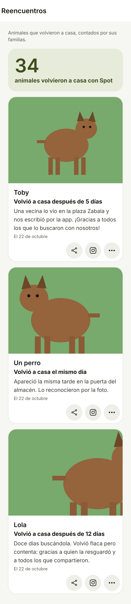
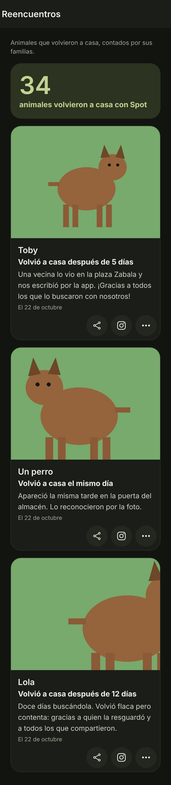
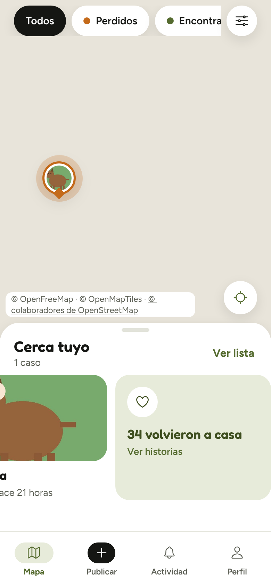
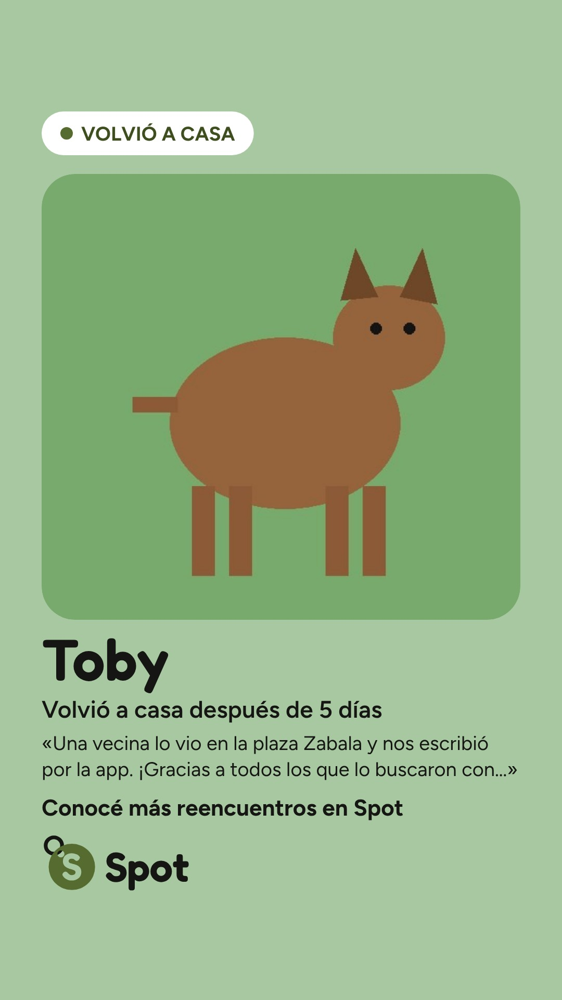
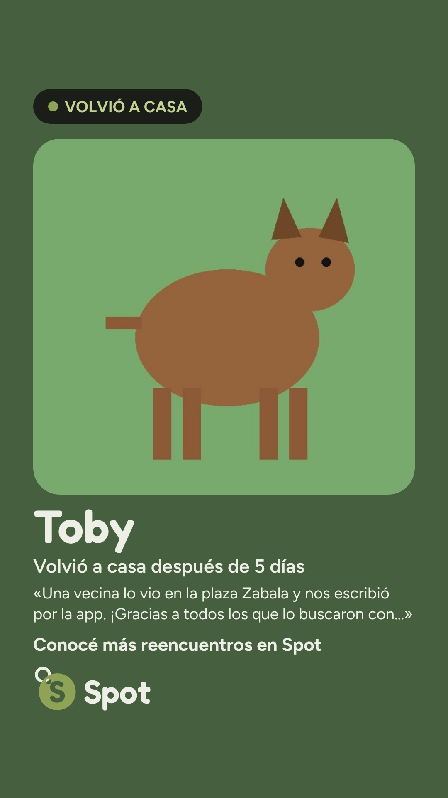
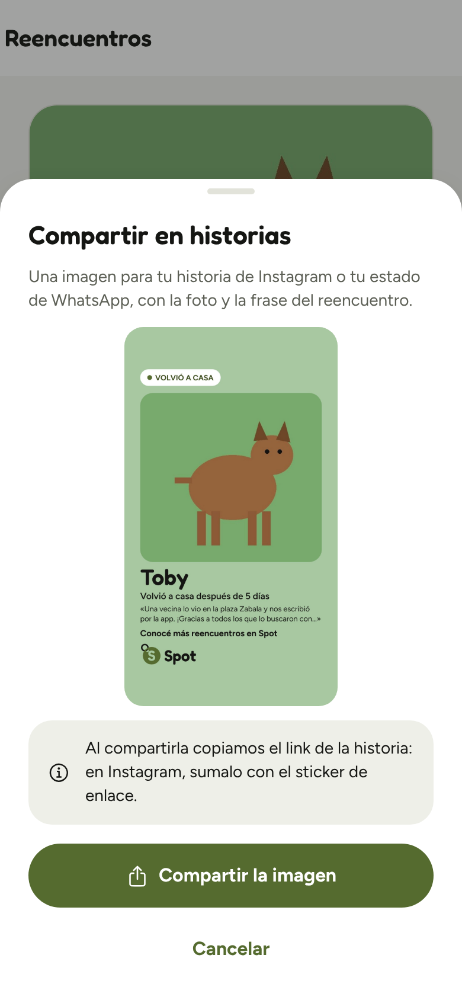

# Muro de reencuentros · 2026-10-22

## 1. Resumen

**Qué se pidió:** un muro con los finales felices de Spot y el agradecimiento a quienes ayudaron. La familia cuenta cómo volvió (opcional), le agradece a quien participó, y un muro público muestra el contador y las historias, que se comparten con su link y como historia de Instagram. Se moderan con lo que ya existe. Sin aplicar nada en producción.

**Qué se hizo:**
- **Contar cómo volvió.** Al marcar su perdido como reunido, la familia ve "¡Qué alegría! ¿Querés contar cómo volvió?" (con "Ahora no"). También puede hacerlo después, desde "Cómo volvió" en el caso. El formulario tiene:
  - una foto opcional (si no hay, la del caso), con el aviso de que las personas de la foto estén de acuerdo;
  - una frase de hasta 280 caracteres;
  - si se muestra el nombre.

  Los teléfonos, links y emails se tapan con `ocultar_datos_de_contacto`. La familia la edita o la borra cuando quiera, y borrar la cuenta la borra.
- **Agradecer.** En el mismo formulario aparece la lista de quienes participaron, con su nombre público: avisaron que lo vieron, lo resguardaron o le escribieron. La familia marca a quién y suma un mensaje opcional, también tapado.
  - Cada persona lo recibe en Actividad y en el celular: "La familia de Toby te agradeció".
  - En su perfil: "Ayudaste a reunir a N familias", que cuenta solo lo agradecido.
  - Los agradecimientos no son públicos.
- **El muro** (`/reencuentros`, sin cuenta):
  - el contador "N animales volvieron a casa con Spot", sin ocultos ni datos de demo; con menos de 5, "Los primeros reencuentros de Spot";
  - las historias más recientes: foto, nombre si la familia quiso, "Volvió a casa después de X días", la frase y la fecha. No nombra a nadie ni muestra la ubicación;
  - se entra desde una tarjeta al final de "Cerca tuyo" y desde Perfil;
  - cada historia se comparte con su link (`/reencuentros/<id>`, con vista previa en `api/vista-previa`) y como historia de Instagram, con la variante "VOLVIÓ A CASA";
  - las historias se denuncian aparte del caso y moderación las oculta.
- **Base.** Dos migraciones:
  - **0025:** el tipo de aviso `agradecimiento`. Va aparte porque Postgres no deja usar un valor nuevo de un enum en la misma transacción.
  - **0026:** las tablas `historias_reencuentro` y `agradecimientos`, con RLS, y las RPC. El muro y el contador se leen con RPC que devuelven solo lo público.
- **Sin sumar a la carga inicial.** Todo va en bloques aparte; la hoja de denuncia también pasó a cargarse al tocarla. Medido en la sección 3.

**Decisiones** (detalle en `docs/DECISIONES.md`):
- **Solo los perdidos tienen historia y agradecimientos.** "La familia" es quien publicó el perdido, la misma regla que cierra el caso. Un encontrado reunido suma al contador, pero no tiene a nadie que hable por el animal.
- **Datos de demo:** los casos cuya foto es una URL de otro sitio.
- **Días:** de la fecha del perdido a la del último cambio a reunido, en hora de Montevideo.
- **La frase va en la imagen de Instagram y no en la vista previa del link.**

**Lo que encontraron las pruebas y se arregló:**
- En el detalle de un caso reunido, la tarjeta de la historia repetía el nombre del animal como un segundo título. Ahora va sin el nombre.
- Con el caso oculto por moderación, la historia del caso seguía ofreciendo "Compartir". Ahora una historia oculta, o de un caso oculto, se muestra sin compartir: solo la ven la familia y moderación.
- `avisos_push.sql` exigía `avisar_url` vacía al empezar, y en producción ya está configurada desde el cierre anterior. Esa exigencia se sacó: la prueba carga su propia URL dentro de la transacción.

### El muro, en claro y en oscuro

| Claro | Oscuro |
| --- | --- |
|  |  |

Son 34 casos reunidos: 3 con historia. Coco tiene el nombre apagado, así que sale "Un perro". Es el build real en Chromium, a 390 px y en una ventana alta para verlo entero, contra el Supabase simulado. La foto es `e2e/datos/perro.jpg` y dos recortes de ella.

### La entrada desde "Cerca tuyo"



### La historia de Instagram "VOLVIÓ A CASA"

| Claro | Oscuro | La hoja |
| --- | --- | --- |
|  |  |  |

Son los archivos que entrega la app (los que recibe `navigator.share`). La frase de Toby no entra en dos líneas y termina en "…»".

## 2. Cambios

**Base**
- `supabase/migrations/20261022000025_tipo_notificacion_agradecimiento.sql` (nuevo): el valor `agradecimiento` del enum `tipo_notificacion`.
- `supabase/migrations/20261022000026_reencuentros.sql` (nuevo):
  - **Tablas y RLS:** `historias_reencuentro` la leen solo la familia y moderación. `agradecimientos` lo leen la familia y quien lo recibe, si ve el caso. Las dos llevan checks de largo y de datos de contacto.
  - **Funciones internas:** `es_foto_de_demo`, `nombre_publicable`, `datos_del_reencuentro`, `caso_de_la_familia`, `foto_en_uso`, `archivos_de_foto`, `participantes_internos` y `hay_historia`.
  - **RPC con cuenta:** `guardar_historia_reencuentro`, `fotos_de_la_historia`, `borrar_historia_reencuentro`, `participantes_del_caso`, `agradecer` y `familias_que_ayude`.
  - **RPC públicas:** `contador_reencuentros`, `muro_reencuentros` e `historia_reencuentro`.
  - **Denuncias:** columna `historia`, unicidad por usuario, caso y tipo, y la política de crear. `ocultar_por_denuncias` cuenta aparte las del caso y las de la historia. `denuncias_detalle` suma los datos de la historia.
  - **Moderación:** `moderar_historia`.
  - **Funciones rehechas:** `preparar_avisos_push` agrupa el agradecimiento aparte, `fotos_del_reporte` suma las fotos de la historia y `limpiar_cuenta` borra historias y agradecimientos.
- `supabase/tests/reencuentros.sql` (nuevo): 13 secciones con las cinco reglas pedidas y más (sección 3).
- `supabase/tests/avisos_push.sql`: FALLA 0 ya no exige `avisar_url` vacía, para poder correrla en producción con la función conectada.
- `supabase/tests/README.md`: base 0001–0026, filas de `avisos_push.sql` (faltaba) y `reencuentros.sql`.

**Función `avisar`**
- `supabase/functions/avisar/textos.ts`: los textos del agradecimiento ("La familia de Toby te agradeció" o "La familia del perro…", y "Gracias por ayudar a que volviera a casa."), copiados de `t.avisosPush`.
- `supabase/functions/avisar/aviso.ts`: el tipo `agradecimiento`, que lleva a `/actividad`, con su `tag` por caso y sin `Topic`.
- `supabase/functions/avisar/pruebas/aviso_test.ts`: la prueba del agradecimiento.

**Vista previa del link**
- `api/vista-previa.ts`: el link de una historia (`/reencuentros/<id>` o `?historia=`) lee `historia_reencuentro` con la clave pública. Arma "Toby volvió a casa", los días y la miniatura de la foto, sin la frase. Si la historia no existe o está oculta, usa las genéricas del muro. Con un caso y una historia a la vez, no usa ninguno.
- `vercel.json`: reescribe `/reencuentros/:id` de los bots de vista previa a la función.

**App: el muro**
- `src/components/reencuentros/Reencuentros.tsx` (nuevo): un solo bloque aparte con el muro, la página de una historia y "Cómo volvió" en el caso. Las acciones de una historia son compartir, Instagram, ver el caso y denunciar.
- `src/components/reencuentros/Contador.tsx` (nuevo): el bloque chico con la consulta del contador, la tarjeta de "Cerca tuyo" y `ConContador`, que usa el muro.
- `src/app/reencuentros/index.tsx` y `src/app/reencuentros/[id].tsx` (nuevos): rutas finas, con `lazy`.
- `src/features/reencuentros/` (nuevo), módulos separados según quién los usa, para que nada entre en `__common`:
  - `claves.ts`;
  - `contador.ts` (con `numeroVisible`);
  - `historia.ts`;
  - `muro.ts` (con el "ya denunciaste" de la historia);
  - `contar.ts` y `reglas.ts`, que usa el formulario;
  - `ayude.ts`, que usa Perfil.
- `src/components/mapa/TarjetaReencuentros.tsx` (nuevo): en el bloque del mapa queda solo el `lazy` de la tarjeta.
- `src/components/mapa/HojaCercaTuyo.tsx` y `PanelCasos.tsx`: la tarjeta al final del carrusel y de la lista.
- `src/app/(tabs)/perfil.tsx`: la sección Reencuentros ("Ayudaste a reunir…" y "Ver las historias").
- `src/features/reportes/precarga.ts`: adelanta la historia y su foto cuando se entra por `/reencuentros/<id>`.
- `src/app/_layout.tsx`: registra las rutas `/reencuentros`, `/reencuentros/[id]` y `/animal/[id]/reencuentro`, esta última solo con sesión.

**App: contar y agradecer**
- `src/app/animal/[id]/reencuentro.tsx` (nuevo): el formulario (foto, frase, nombre, quienes participaron, mensaje, borrar), detrás de los términos.
- `src/components/reportes/AccionesCaso.tsx`: "¡Qué alegría!" después de reunir. La hoja de denuncia pasa a cargarse con `lazy` y refresca el "ya denunciaste" al terminar.
- `src/components/reportes/DetalleCaso.tsx`: "Cómo volvió" en un caso reunido, cargado con `lazy`.
- `src/components/reportes/SelectorFoto.tsx`: `vistaPrevia`, para mostrar la foto del caso.
- `src/app/(tabs)/actividad.tsx`: el ícono del agradecimiento.

**App: denuncias y moderación**
- `src/components/reportes/ModalDenuncia.tsx`: `export default` (va en su propio bloque) y los textos de la historia.
- `src/features/denuncias/api.ts`: solo la consulta de la denuncia del caso (`historia = false`).
- `src/features/denuncias/denunciar.ts` (nuevo): mandar la denuncia; solo lo usa la hoja.
- `src/app/moderacion.tsx` y `src/features/moderacion/api.ts`: en una denuncia de historia, la frase, "Ver la historia" y ocultarla o volver a mostrarla.

**App: la historia de Instagram**
- `src/features/historias/disenio.ts`:
  - `datosDeReencuentro`, con solo nombre, especie, días y frase;
  - `disenioReencuentro`, sobre una base común;
  - `partirEnLineas`, que corta la frase con "…»".
- `src/features/historias/generarHistoria.web.ts` y `generarHistoria.ts`: reciben las dos variantes y dibujan texto en varias líneas.
- `src/components/historias/HojaHistoria.tsx`: arma la historia de un caso o de un reencuentro (su link, su título y su pista).

**Compartido**
- `src/i18n/es-UY.ts`: todos los textos del muro, de contar y de agradecer, de Perfil, de moderación y de los avisos.
- `src/constants/tema.ts`: la variante `contador` (Fredoka 56/60).
- `src/lib/compartir.ts`: `linkDeHistoria`.
- `src/lib/imagenes.ts`: `urlMediana`.
- `src/types/database.ts`: a mano, con las tablas, columnas, vistas, funciones y el valor del enum nuevos.

**Pruebas**
- `__tests__/reencuentros.test.ts` (nuevo): el número del contador, los textos (días, título, link y perfil) y las reglas del formulario (el largo como la base, qué hace el botón y por qué no se guarda).
- `__tests__/historia.test.ts`: la variante "VOLVIÓ A CASA":
  - medidas y lugares;
  - contraste con 125 colores de foto en claro y oscuro;
  - textos;
  - sin datos privados;
  - cómo parte la frase en líneas.
- `__tests__/vista-previa.test.ts`:
  - la vista previa de una historia;
  - que se pida por la RPC pública;
  - sin la frase;
  - genérica si está oculta o no existe;
  - un caso y una historia a la vez;
  - que `vercel.json` mande a los bots.
- `__tests__/precarga.test.ts`: `/reencuentros/<id>`.
- `__tests__/avisosPush.test.ts`: los textos del agradecimiento en la función y en `es-UY.ts`.
- `e2e/flujos.spec.ts`: el flujo completo:
  1. reunir y ver "¡Qué alegría!";
  2. contar con foto y un teléfono que se tapa, y agradecerle a la vecina;
  3. ver el muro sin cuenta, sin nombrar a nadie, compartirla con su link y como imagen "VOLVIÓ A CASA";
  4. a la vecina le llega el agradecimiento en Actividad y Perfil dice "Ayudaste a reunir a 1 familia.";
  5. con el caso oculto, la historia tampoco se ve.
- `e2e/ayudas.ts`: `simularHojaConArchivos` y `leerImagenCompartida`, que ahora usan las dos pruebas de historias.
- `e2e/LEEME.md`: los pasos nuevos.

**Documentación**
- `docs/ARQUITECTURA.md`: piezas, el flujo nuevo, vista previa, avisos, casos ocultos, modelo, RPC, seguridad, carga inicial, despliegue y pruebas.
- `docs/DECISIONES.md`: "Muro de reencuentros".
- `docs/DISENO.md`:
  - contrastes nuevos (2.4) y la variante `contador`;
  - la tarjeta en 6.7, 6.18.1 "VOLVIÓ A CASA", 6.19 el muro y 6.20 contar cómo volvió;
  - detalle, Actividad, Perfil, Moderación, anchos y textos.
- `docs/PRUEBAS-MANUALES.md`: el paso 32.
- `README.md` y `AGENTS.md`: la regla del muro, el generador, la estructura, las migraciones 0001–0026 y la fase.
- Este reporte y sus capturas, en `docs/reportes/2026-10-22-reencuentros/`.

## 3. Verificaciones

| Verificación | Resultado |
| --- | --- |
| `npm run typecheck` | Sin errores. |
| `npm run lint` | Sin errores ni avisos. |
| `npm run test` | 31 suites, 333 pruebas, todas bien. Antes eran 30 y 306. |
| `npx expo export -p web` | Bien (`dist/`). |
| Deno en `supabase/functions/avisar` | `deno test --allow-env`: 25 pruebas bien. `deno lint`: 12 archivos sin problemas. `deno fmt --check`: 13 archivos bien. |
| Pruebas SQL (`supabase/tests/`) | 13 de 13 bien, en Postgres 16 local con las migraciones 0001–0026 y el seed. Se corrieron con `avisar_url` vacía y con la función "conectada", como está producción. `reencuentros.sql` y `avisos_push.sql` no dejan filas. |
| e2e (`npm run e2e`) contra el build real y un Supabase simulado | Teléfono: 20 de 20. Computadora: 20 de 20 (19 flujos y la notificación del service worker). |

Más sobre cada verificación:
- **Pruebas SQL nuevas:** cubren las cinco reglas pedidas, cada una en su sección de `reencuentros.sql`:
  - el muro no muestra datos privados: las claves exactas de cada fila y nada de quién publicó, quién ayudó, contactos ni ubicación;
  - solo la familia publica, edita o borra su historia;
  - el contador no cuenta ocultos ni datos de demo;
  - solo cuentan los agradecimientos de la familia;
  - los datos de contacto se tapan, y la base rechaza los que lleguen sin tapar.
- **Las pruebas SQL detectan errores:** se comprobó con tres cambios a propósito, y cada uno hizo fallar `reencuentros.sql`:
  - un contador que cuenta los datos de demo;
  - `agradecer` sin comprobar que la persona participó;
  - guardar la frase sin tapar y sin el check.
- **e2e:** no hay proyecto spot-pruebas con credenciales en este entorno. La primera corrida contra spot-pruebas es la que cuenta (`e2e/LEEME.md`). Si corren los dos perfiles en una sola pasada, el Supabase simulado falla en el segundo: el primero borra las cuentas que comparten. En spot-pruebas, cada perfil crea las suyas.

**Carga inicial.** Mismo build y mismas variables, comparado con `main` (`163ac3f`). Bytes sin comprimir y con gzip -9:

| Bloque | main | esta rama | Diferencia gzip | Qué es |
| --- | --- | --- | --- | --- |
| `entry` | 1.109.786 / 290.637 | 1.109.945 / 290.730 | +93 B | El registro de las tres rutas nuevas. |
| `__common` (se baja siempre) | 687.993 / 189.023 | 694.325 / 190.909 | +1.886 B | Los textos de `es-UY.ts` (+5,2 KB sin comprimir) y `claves.ts` e `historia.ts` (863 B sin comprimir), que usa la precarga. |
| `_layout` | 10.483 / 3.812 | 11.146 / 3.939 | +127 B | La precarga de `/reencuentros/<id>` y las rutas. |
| Mapa (`/`) | 19.055 / 7.563 | 19.927 / 7.857 | +294 B | El `lazy` de la tarjeta. |
| Detalle del caso | 61.966 / 21.382 | 61.000 / 21.123 | −259 B | La hoja de denuncia salió a su bloque. |

Total en la primera visita: unos 2,4 KB comprimidos en `/` y 1,85 KB en `/animal/<id>`. Casi todo son los textos, que por regla viven en un solo archivo.

Lo nuevo va en bloques que se bajan al usarlos (gzip):

| Bloque | Tamaño | Cuándo se baja |
| --- | --- | --- |
| `Reencuentros` | 6,3 KB | El muro, la página de una historia y "Cómo volvió". |
| `reencuentro` | 6,5 KB | El formulario. |
| `Contador` | 1,7 KB | La tarjeta y el contador, después de que el mapa mostró sus casos. |
| `ModalDenuncia` | 1,4 KB | Al tocar "Denunciar". |
| `HojaHistoria` | +0,8 KB | La variante "VOLVIÓ A CASA". |

Se revisó con mapas de fuentes qué entra en `__common`: de lo nuevo, solo lo que lista la tabla.

## 4. Pasos manuales (los hace el dueño; no se aplicó nada en producción)

Proyecto `bwqvuttuodwypwxckxgf`. **El orden importa:** la app nueva usa `denuncias.historia` y las RPC nuevas, así que la base va antes del merge. Si el deploy de Vercel saliera antes que la base, denunciar un caso fallaría hasta aplicar la 0026.

1. **Desplegar de nuevo la función `avisar`,** que ahora sabe armar el agradecimiento. Es compatible con la base actual, así que va primero:
   ```bash
   npx supabase functions deploy avisar --project-ref bwqvuttuodwypwxckxgf --use-api --no-verify-jwt
   ```
   No hay secretos ni claves nuevas: los VAPID y `avisar_secret` siguen como están.
2. **Migraciones 0025 y 0026.** Con el proyecto enlazado, `npx supabase db push` aplica cada una en su transacción y las registra. Si se hace en el SQL Editor, va en este orden:
   1. Pegá `supabase/migrations/20261022000025_tipo_notificacion_agradecimiento.sql` sola y tocá **Run**. Tiene que ir sola: el valor nuevo del enum no se puede usar en la misma transacción.
   2. Pegá `supabase/migrations/20261022000026_reencuentros.sql` entera y tocá **Run**.
   3. Registralas:
      ```sql
      insert into supabase_migrations.schema_migrations (version, name) values
        ('20261022000025', 'tipo_notificacion_agradecimiento'),
        ('20261022000026', 'reencuentros');
      ```
   4. Comprobá:
      ```sql
      select count(*) from historias_reencuentro;   -- 0
      select count(*) from agradecimientos;          -- 0
      select public.contador_reencuentros();         -- los casos reunidos de hoy, sin ocultos ni demo
      select count(*) from denuncias where historia; -- 0
      ```
3. **Las 13 pruebas de `supabase/tests/`, de a una**, en el SQL Editor:
   - `auditoria_2`, `avisos_push`, `contacto_al_cerrar`, `errores`, `fase5_permisos`, `fase6_perdidos`, `fase7_cuenta`, `fase8_casos`, `fase9_parte2`, `fase9_revision`, `reconocimiento_ia`, `reencuentros` y `vision`.
   - Cada una termina en `Success. No rows returned` y en `rollback`: no deja datos.
   - Desde este cambio, `avisos_push.sql` corre con la función ya conectada.
4. **Tipos:** `npm run db:types` con el proyecto enlazado tiene que dar lo mismo que `src/types/database.ts`, escrito a mano. Si difiere, commitear lo generado.
5. **Merge del PR** y esperar el deploy de Vercel en READY. No hay variables nuevas, y la CSP no cambia: no hay orígenes nuevos.
6. **En producción:**
   - `/reencuentros` muestra el contador.
   - La vista previa del link de una historia, con user-agent de bot:
     ```bash
     curl -s -A "WhatsApp/2.23.20" https://animales-blue.vercel.app/reencuentros/<id> | grep og:title
     ```
     Con un id sin historia, da las etiquetas genéricas "Reencuentros en Spot".
   - Después, el paso 32 de `docs/PRUEBAS-MANUALES.md` en Android, iPhone y computadora.

**Si algo sale mal:** el muro y el contador solo leen. Para sacar una historia, se oculta desde **Moderación** ("Ocultar la historia" en su denuncia) o, en el SQL Editor:
```sql
update historias_reencuentro set oculta = true, updated_at = now() where animal_id = '<animal_id>';
```
La familia también la puede borrar. La 0026 no cambia datos existentes: suma tablas, la columna `denuncias.historia` (con default `false`), una restricción única que la incluye y funciones, y rehace algunas políticas, la vista `denuncias_detalle` y las funciones de la sección 2.

## 5. Pendientes y riesgos

- **Privacidad:** el texto de los términos y la privacidad (`t.legal`) no menciona el muro, las historias ni los agradecimientos. Conviene sumarlo en la próxima versión. No se cambió acá: cambiarlo pide subir `VERSION_TERMINOS` y `terminos_version`, y todos tendrían que volver a aceptar.
- **e2e contra un backend real:** se corrió contra el build real y un Supabase simulado. Falta la primera corrida contra spot-pruebas.
- **Sin casos cerca no hay tarjeta:** la hoja "Cerca tuyo" queda solo con la barra y la tarjeta no se ve. Al muro se llega igual desde Perfil y por los links.
- **La ruta de la foto lleva el id de la familia**, como toda foto del bucket público. No es un dato de contacto, pero quien mire el muro podría relacionar dos historias de la misma familia.
- **Empates al paginar:** el muro pagina por `reunido_en`. Dos historias con exactamente el mismo instante en el borde de una página podrían saltearse una. Es improbable (microsegundos); si pasa, se resuelve sumando el id al cursor.
- **Encontrados:** suman al contador, pero no tienen historia ni agradecimientos (decisión de la sección 1).
- **Las personas en la foto:** hay un aviso, pero no hay detección. Lo cubre la denuncia y la moderación.
- **Lo que se tapa:** `ocultar_datos_de_contacto` tapa cualquier número de 6 cifras o más (por ejemplo "123456 pasos"), igual que en los textos de la IA. Las fechas y los números cortos no se tocan.
- **El nombre en el aviso al celular:** el agradecimiento dice el nombre del animal aunque la familia lo haya apagado para el muro. El aviso es privado, para quien ya conocía el caso, y sigue la regla de la pantalla bloqueada: el nombre si no parece un contacto, o la especie.
- **La primera denuncia** (del caso o de una historia) baja su bloque al tocarla: unos 1,4 KB.
- **PR:** el reporte de cierre anterior (`8f55cf8`, solo documentación) todavía no se mergeó y usa la misma rama. Este commit se suma a ese PR, que pasa a llevar los dos.
